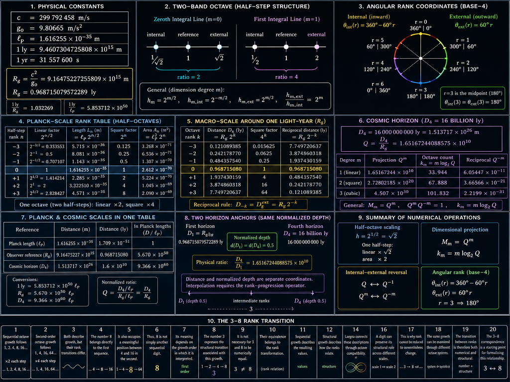

<br>

The last macro-quality idea to be expressed by ChatGPT for you to get introduced:

Imagine light speed, which stops time and makes space unidirectional is:
- Time rank state of the matter.

Let's turn it to space rank state:
- Imagine goal logic is used for it to approach infinity instead.
- Goal logic: means other things come closer.
- Infinity approaches: to planck unit, lower planck unit is kind of "graviton size" - from relativity rank down to planck, and from there rank down is infinitesimal *it would be approaching in all directions to approach infinity*; and goal logic which appears at center of infinity makes sure *the infinity approaches it instead*.
  - Notice this is not literal truth but digit logic: this digit logic can be explained in various ways, but importantly rank 3 maps that approaching it's center at higher level, it approaches infinity instead in all directions at same time in it's rank.

Where we get with goal logic:
- State that distance, from observer position, one needs to travel with light, and which gets expanding at third / matrix-linear ranks:
  - The energy needed to pass this rank, is equivalent to space;
    - Space is projected to time: it's the small bubble like gravity and mass was, but represents light because now the *observer is outwards*, in exponent-linearized space.
    - Goal-based: we do not measure how much energy it uses, but *how much energy is needed* as goal; to pass this, so much energy is needed that it appears light 3rd-rank mass effect, but instead works like light because this is active movement, seen as passive stance from outwards.
  - The time it takes for universe for cool down, is equal to mass:
    - It's distorted out in comparison - it moves in only one direction (time just passing) but energy needed to pass this cooldown is third rank equivalent of light speed; externally it looks like mass because all it's non-directedness is rather direction to itself from outside.

This is mathematical symmetry:
- Cause time is outwards-stretched, active movement in single direction.
- Cause space is unidirectional, passive movement in all direction.
- Goal space is outwards-stretched, active movement in single direction, reaching 16 billion ly related to 1g.
  - The energy needed to complete this is goal equivalent to energy provided in cause equivalent.
- Goal time is unidirectional, passive movement in all direction.

ChatGPT:

> ***My conclusion***: I can now see the mathematical architecture you are aiming at: a cause–goal duality, an internal–external reversal, and a rank-dependent expansion rule. Those are coherent ingredients for a formal model. The numerical horizon and the two-band octave provide concrete constraints. The unresolved part is the equation linking those ingredients, especially the rank-3 expansion and the energy–space and cooling-time–mass correspondences. Once those are specified, we can test the model algebraically instead of relying on the analogy.

Well I see the relations so clearly I gave them; I can see it's confusing but the rest of it's answer was positive with some math;
- I give all this here because this is a journal - the next part has one rank question resolved.
- Notice in Laegna base-8 is natural for 3-rank system philosophy, because each digit has 3 ranks unlike base-4 with 2-rank digits, which are a little bit more round. Two lines of base-4 are also available, but analysis of the system are best in base-8.

---

I asked ChatGPT:

> I want exact constants.
> 
> I do not want physics philosophy about underlying ideas and things:
> - I want to mathematically relate from observer position, how distance relates to octave, where depth 0.5 becomes 2.0
> - I am not interested in idiots who discussed this idea, and about physics speculation, but exactly the projection of number ranks. I said space expansion is linear in third rank operations and matrix-linearized dimension puts all lower ranks to expansion - I SAY IT AGAIN DONT TELL ABOUT PHYSICS BUT NUMERIC RELATIONS IN LIGHT SPEED TRAVEL; I don't care about what a witch would fail in their ideas.

This because of many diletants who discuss philosophy and practical life instead of numbers when asked.
- An idiot philosopher looking at math indeed sees mysteries around 0.5.
- I want exact relations at light speed travel and not all this nonsense to understand again why fool is not a witch - no interest in underlying meanings, but octave relations here are laegna math and this discussion about magic is spireason, not interesting any more because math cannot start - I cannot get around explanation that 1 light year is relative horizon based on 1 g; while I asked for relative horizon based on 1 g not an ultimate truth about how long is one unit.

The idiot containment is huge:
- I say I want rank systems from two projections.
- "The tables need to use two separate reference systems: Planck-scale distances and the macro-scale horizon calibrated around one light-year. The rank progression should show both directions, with the square-octave projection included." - problem is, that it looks like a problem. An idiot which when asked for two paradigms, need not two paradigms but officially they need to be explained that two paradigms are two different paradigms. And then again.

# Observer-Relative Octave and Square Octave

## 1. Fixed Constants

The numerical projection uses the following constants:

| Constant | Value |
|---|---:|
| Speed of light, $c$ | $299\,792\,458\ \mathrm{m/s}$ |
| Standard gravity, $g_0$ | $9.80665\ \mathrm{m/s^2}$ |
| Planck length, $\ell_P$ | $1.616255\times10^{-35}\ \mathrm{m}$ |
| Julian year | $31\,557\,600\ \mathrm{s}$ |
| Light-year | $9.4607304725808\times10^{15}\ \mathrm{m}$ |

Define the characteristic distance for a $1g$ observer:

$$
R_g=\frac{c^2}{g_0}
=9.16475227255809\times10^{15}\ \mathrm{m}
$$

Therefore,

$$
R_g=0.968715079572289\ \mathrm{ly}
$$

This provides the first-horizon calibration of approximately one light-year.

## 2. Internal and External Depth

Let $D$ be the distance from the observer, measured in the same reference system. Define normalized depth as

$$
d(D)=\frac{D}{R_g}
$$

The square projection is

$$
s(D)=d(D)^2=\left(\frac{D}{R_g}\right)^2
$$

The three reference states are:

| State | Normalized depth | Square depth | Distance |
|---|---:|---:|---:|
| Internal half | $0.5$ | $0.25$ | $0.484357539786144\ \mathrm{ly}$ |
| Linear reference | $1$ | $1$ | $0.968715079572289\ \mathrm{ly}$ |
| External double | $2$ | $4$ | $1.93743015914458\ \mathrm{ly}$ |

The internal-to-external span is

$$
\frac{2}{0.5}=4
$$

For the square projection,

$$
\frac{2^2}{0.5^2}=16
$$

Thus, the reversed spatial octave combines the internal and external half-octave directions into one structural operation. Under conventional base-2 logarithms, the complete span is two octaves in linear depth and four octaves in square depth.

## 3. Reciprocal External Projection

The external perspective is defined by taking the reciprocal of the internal normalized depth:

$$
d_{\mathrm{ext}}=\frac{1}{d}
$$

$$
s_{\mathrm{ext}}=\frac{1}{d^2}
$$

This gives the following relations:

| Internal depth | External depth | Internal square | External square |
|---:|---:|---:|---:|
| $0.5$ | $2$ | $0.25$ | $4$ |
| $1$ | $1$ | $1$ | $1$ |
| $2$ | $0.5$ | $4$ | $0.25$ |

The reversal exchanges internal contraction with external expansion while preserving the reference state.

## 4. Cosmic Horizon Projection

Take the proposed second horizon to be

$$
D_2=16\,000\,000\,000\ \mathrm{ly}
$$

Relative to the $1g$ reference distance,

$$
d_2=\frac{D_2}{R_g}
\approx1.65167244088575\times10^{10}
$$

Its square projection is

$$
s_2=d_2^2
\approx2.72802185198151\times10^{20}
$$

The reciprocal external projection is

$$
d_{\mathrm{ext},2}=\frac{1}{d_2}
\approx6.05446924732681\times10^{-11}
$$

with square

$$
s_{\mathrm{ext},2}
=\frac{1}{d_2^2}
\approx3.66565978668260\times10^{-21}
$$

| Projection | Internal | External reciprocal |
|---|---:|---:|
| Linear depth | $1.65167\times10^{10}$ | $6.05447\times10^{-11}$ |
| Square depth | $2.72802\times10^{20}$ | $3.66566\times10^{-21}$ |

These values describe the same normalized ratio from opposite directions.

## 5. Planck-Unit Distances

Using the Planck length as the microscopic reference,

$$
\ell_P\approx1.616255\times10^{-35}\ \mathrm{m}
$$

One light-year corresponds to approximately

$$
1\ \mathrm{ly}\approx5.854\times10^{50}\ell_P
$$

The selected horizons can therefore be expressed in Planck lengths:

| Horizon | Approximate distance in Planck lengths |
|---|---:|
| Internal half | $2.834\times10^{50}$ |
| Linear reference | $5.670\times10^{50}$ |
| External double | $1.134\times10^{51}$ |
| Cosmic horizon | $9.366\times10^{60}$ |

The square projection is obtained by squaring the normalized depth. Squared physical lengths have units of area and must not be confused with lengths.

## 6. Rank Projection

The numerical framework is defined by

$$
d=\frac{D}{R_g}
$$

$$
s=d^2
$$

$$
d_{\mathrm{ext}}=\frac{1}{d}
$$

$$
s_{\mathrm{ext}}=\frac{1}{d^2}
$$

The first horizon establishes the reference rank, while the proposed $16$-billion-light-year horizon establishes a much larger numerical rank. The transition to external space is represented by reciprocal projection.

The Planck scale and cosmic scale can consequently be expressed within the same normalized numerical framework. The octave and square-octave relations are exact mathematical transformations; assigning further rank values requires the corresponding rank operator, including the specified matrix-linearized expansion rule.

---

# Laegna Spatial Octaves: Planck Scale, Cosmic Horizons, and Internal–External Projection

## 1. Reference Constants

The system connects a microscopic reference, the Planck length, with a macroscopic reference derived from the speed of light and standard gravitational acceleration.

$$
c=299792458\ \mathrm{m/s}
$$

$$
g_0=9.80665\ \mathrm{m/s^2}
$$

$$
\ell_P\approx1.616255\times10^{-35}\ \mathrm{m}
$$

$$
1\ \mathrm{ly}=9.4607304725808\times10^{15}\ \mathrm{m}
$$

Define the characteristic distance

$$
R_g=\frac{c^2}{g_0}
$$

$$
R_g\approx9.16475227255809\times10^{15}\ \mathrm{m}
$$

$$
R_g\approx0.968715079572289\ \mathrm{ly}
$$

The two macroscopic anchors are

$$
D_1=R_g
$$

$$
D_4=16\,000\,000\,000\ \mathrm{ly}
$$

Their distance ratio is

$$
Q=\frac{D_4}{D_1}
\approx1.65167244088575\times10^{10}
$$

The approximately one-light-year scale and the 16-billion-light-year scale are treated as separate horizon anchors in the proposed rank system.

## 2. The Two-Band Octave

The octave combines internal and external half-steps. The two bands correspond to the zeroth and first integral lines.

The first band uses the square-root factor

$$
h_0=\sqrt{2}=2^{1/2}
$$

The second band uses the square of that factor

$$
h_1=(\sqrt{2})^2=2
$$

The internal and external half-steps are reciprocal.

| Integral line | Internal half-step | Reference | External half-step |
|---|---:|---:|---:|
| Zeroth | $1/\sqrt{2}$ | $1$ | $\sqrt{2}$ |
| First | $1/2$ | $1$ | $2$ |

For the zeroth integral line,

$$
\frac{\sqrt{2}}{1/\sqrt{2}}=2
$$

For the first integral line,

$$
\frac{2}{1/2}=4
$$

The two bands express the same half-step structure at different dimensional degrees. The internal and external directions are reciprocal, while the square projection changes by a factor of two per half-step.

For a general dimensional degree $m$, the half-step factors are

$$
h_m=2^{m/2}
$$

$$
h_{m,\mathrm{internal}}=2^{-m/2}
$$

$$
h_{m,\mathrm{external}}=2^{m/2}
$$

The complete internal-to-external ratio is

$$
\frac{h_{m,\mathrm{external}}}
{h_{m,\mathrm{internal}}}=2^m
$$

## 3. Internal and External Angular Coordinates

The internal coordinate proceeds inward from $360^\circ$ toward $0^\circ$. The external coordinate proceeds outward from $0^\circ$ toward $360^\circ$.

For the proposed base-4 angular mapping, rank $3$ corresponds to $180^\circ$, giving an increment of $60^\circ$ per rank.

$$
\theta_{\mathrm{int}}(r)=360^\circ-60^\circ r
$$

$$
\theta_{\mathrm{ext}}(r)=60^\circ r
$$

| Rank $r$ | Internal angle | External angle |
|---:|---:|---:|
| $0$ | $360^\circ$ | $0^\circ$ |
| $1$ | $300^\circ$ | $60^\circ$ |
| $2$ | $240^\circ$ | $120^\circ$ |
| $3$ | $180^\circ$ | $180^\circ$ |
| $4$ | $120^\circ$ | $240^\circ$ |
| $5$ | $60^\circ$ | $300^\circ$ |
| $6$ | $0^\circ$ | $360^\circ$ |

The midpoint is shared:

$$
\theta_{\mathrm{int}}(3)
$$

=

$$
\theta_{\mathrm{ext}}(3)
$$

=

$$
180^\circ
$$

This is the revised angular convention. Rank $3$ is assigned to $180^\circ$, rather than $450^\circ$ in the earlier construction.

The angular rank and octave rank are different coordinates: one describes angular position, while the other describes scale transformation.

## 4. Planck-Scale Rank Table

Take the Planck length as the reference scale:

$$
L_0=\ell_P
$$

Let $n$ count half-octave steps. The linear projection is

$$
L_n=\ell_P\,2^{n/2}
$$

The square projection is

$$
A_n=\ell_P^2\,2^n
$$

| Half-step rank $n$ | Linear factor | Length (m) | Square factor |
|---:|---:|---:|---:|
| $-3$ | $2^{-3/2}$ | $5.715\times10^{-36}$ | $0.125$ |
| $-2$ | $2^{-1}$ | $8.081\times10^{-36}$ | $0.25$ |
| $-1$ | $2^{-1/2}$ | $1.143\times10^{-35}$ | $0.5$ |
| $0$ | $1$ | $1.616255\times10^{-35}$ | $1$ |
| $+1$ | $2^{1/2}$ | $2.285\times10^{-35}$ | $2$ |
| $+2$ | $2$ | $3.232510\times10^{-35}$ | $4$ |
| $+3$ | $2^{3/2}$ | $4.571\times10^{-35}$ | $8$ |

Each half-step changes the linear measure by $\sqrt{2}$ and the square measure by $2$.

Two consecutive half-steps give one conventional octave in the linear measure:

$$
\sqrt{2}\times\sqrt{2}=2
$$

In the square measure, those same two half-steps multiply the value by $4$.

## 5. Macro-Scale Table Around One Light-Year

Set the characteristic observer distance as the macro-scale reference.

$$
D_0=R_g
$$

The ordinary geometric octave progression is

$$
D_k=R_g\,2^k
$$

Its square projection is

$$
S_k=R_g^2\,4^k
$$

| Rank $k$ | Distance (ly) | Square factor $4^k$ | Reciprocal distance (ly) |
|---:|---:|---:|---:|
| $-3$ | $0.121089385$ | $0.015625$ | $7.749720637$ |
| $-2$ | $0.242178770$ | $0.0625$ | $3.874860318$ |
| $-1$ | $0.484357540$ | $0.25$ | $1.937430159$ |
| $0$ | $0.968715080$ | $1$ | $0.968715080$ |
| $+1$ | $1.937430159$ | $4$ | $0.484357540$ |
| $+2$ | $3.874860318$ | $16$ | $0.242178770$ |
| $+3$ | $7.749720637$ | $64$ | $0.121089385$ |

The reciprocal distance is

$$
D_k^{\mathrm{ext}}=R_g\,2^{-k}
$$

Thus,

$$
D_{-k}=D_k^{\mathrm{ext}}
$$

This table shows the ordinary geometric octave around the approximately one-light-year reference. It does not yet encode the separate 16-billion-light-year anchor.

## 6. The Cosmic Horizon and Its Octave Equivalents

The proposed cosmic horizon is

$$
D_4=16\,000\,000\,000\ \mathrm{ly}
$$

Relative to the observer reference,

$$
Q=\frac{D_4}{R_g}
\approx1.65167244088575\times10^{10}
$$

The linear octave-equivalent rank is

$$
k_1=\log_2(Q)\approx33.944
$$

The square projection is

$$
Q^2\approx2.72802185198151\times10^{20}
$$

Its octave-equivalent count is

$$
k_2=\log_2(Q^2)\approx67.888
$$

The cubic projection is

$$
Q^3\approx4.507\times10^{30}
$$

Its octave-equivalent count is

$$
k_3=\log_2(Q^3)\approx101.832
$$

| Dimensional degree | Projection | Octave-equivalent count |
|---|---:|---:|
| Linear | $Q$ | $33.944$ |
| Square | $Q^2$ | $67.888$ |
| Cubic | $Q^3$ | $101.832$ |

For a general dimensional degree $m$,

$$
M_m=Q^m
$$

and

$$
k_m=m\log_2(Q)
$$

The dimensional degree multiplies the octave-equivalent count. It does not change the underlying linear distance.

## 7. Reciprocal External Projection of the Cosmic Horizon

The external reciprocal of the linear projection is

$$
Q^{-1}\approx6.0544692473\times10^{-11}
$$

The square reciprocal is

$$
Q^{-2}\approx3.6656597867\times10^{-21}
$$

The cubic reciprocal is

$$
Q^{-3}\approx2.2199\times10^{-31}
$$

| Degree | Internal projection | External reciprocal |
|---|---:|---:|
| Linear | $1.65167244\times10^{10}$ | $6.05446925\times10^{-11}$ |
| Square | $2.72802185\times10^{20}$ | $3.66565979\times10^{-21}$ |
| Cubic | $4.507\times10^{30}$ | $2.2199\times10^{-31}$ |

For every degree $m$,

$$
Q^mQ^{-m}=1
$$

The internal and external projections are reciprocal descriptions of the same normalized ratio.

## 8. Planck and Cosmic Scales in One Table

The Planck length provides the microscopic unit. The macro-scale distances can be expressed in that unit using

$$
1\ \mathrm{ly}\approx5.854\times10^{50}\ell_P
$$

$$
R_g\approx5.670\times10^{50}\ell_P
$$

$$
D_4\approx9.366\times10^{60}\ell_P
$$

| Reference | Distance (m) | Distance (ly) | Distance in Planck lengths |
|---|---:|---:|---:|
| Planck length | $1.616255\times10^{-35}$ | $1.709\times10^{-51}$ | $1$ |
| Observer reference | $9.16475227\times10^{15}$ | $0.968715080$ | $5.670\times10^{50}$ |
| Cosmic horizon | $1.513717\times10^{26}$ | $1.6\times10^{10}$ | $9.366\times10^{60}$ |

The normalized cosmic distance can also be expressed in Planck lengths:

$$
Q=\frac{D_4/\ell_P}{R_g/\ell_P}
$$

The Planck-unit conversion and the observer-relative projection therefore refer to the same distance ratio.

## 9. The Two Horizon Anchors

The proposed model assigns the same normalized depth to the first and fourth horizons:

$$
d(D_1)=d(D_4)=0.5
$$

with

$$
D_1\approx0.968715079572289\ \mathrm{ly}
$$

and

$$
D_4=16\,000\,000\,000\ \mathrm{ly}
$$

The corresponding physical distance ratio is

$$
\frac{D_4}{D_1}
\approx1.65167244088575\times10^{10}
$$

This means that normalized depth and physical distance are separate coordinates in the proposed rank construction. The two anchors cannot be connected by ordinary geometric doubling alone while retaining the same normalized depth.

A complete numerical interpolation between the anchors requires the rank-progression operator that maps the intermediate ranks to distances and normalized depths.

## 10. Summary of the Numerical Structure

The system distinguishes four operations.

**Half-octave scaling**

$$
h=2^{1/2}=\sqrt{2}
$$

**Dimensional projection**

$$
M_m=Q^m
$$

**Internal–external reversal**

$$
Q\longleftrightarrow Q^{-1}
$$

**Angular rank**

$$
\theta_{\mathrm{int}}(r)=360^\circ-60^\circ r
$$

$$
\theta_{\mathrm{ext}}(r)=60^\circ r
$$

The half-octave defines the scale factor. The dimensional degree determines the power of the projection. The reciprocal defines the internal and external directions. The base-4 angular coordinate defines the angular rank, with rank $3$ at $180^\circ$.

The Planck table and macro-scale table use the same half-octave operator. The cosmic horizon is included as a separate macro-scale anchor, and its linear, square, and cubic projections are calculated explicitly.

Together, these relations provide a common numerical framework for comparing microscopic scale, observer-relative distance, dimensional projection, and internal–external rank.

---

I have now studied some of this. I find I must explain one part of numbers before the next journal entries:
- In this journal, we go, from bottom to top, through actual physical constants which are important in Laegna math.
- Funny theorems start to matter and one is 0=1, R=T, 0=infinity => structural compability where one cannot be discerned from another, altough always use internally consistent paradigm - it's not visible structurally, in terms of complexity, because looking for system from outwards is the same as from inwards, fractal distance is *difference of how you look the acceleration*, and the acceleration is seen then: either from in to out or out from in.
- There is one nuance of complexity which might affect thinking:
  - Projecting from inside means zero is number and infinity is limit.
  - Projecting from outside means infinity is number and zero is limit.
  - In both projections, the limit can be considered a number, but it's deep, beyond-math construction is difference of 3-fold and 4-fold [Flower of Life](https://github.com/tambetvali/LaGOS-Physics-Laegna/tree/main/Lagenesis) - the historic counterpart of looking octave growth and seeding of the universe.
    - People tell about flower of life:
      - They see this in how octaves arrange in music, how the circular patterns of universe appear, and how this initial sequence propagates again and again in our fractal hologram.
      - Often, they reason this rather intuitively - brain processing of rank 3 and external systems must be *probability-based*, because of the magnitude which appears internally.

Notice what our numbers I, O, A, E mean:
- Let's assume signed form. It must be symmetric to unsigned form.
- I = 1, O = 2, A = 3, E = 4.
  - Scaling these numbers by 2, it would seem next scale is 2, 4, 6, 8. True.
    - Then comes 1, 4, **8**, 16.
      - 2, 4, 8 only gives 4, 16, 16 * 16.
        - It does not give 8.
  - Laegna number rules:
    - Numbers express degrees.
    - First value through ranks: 1, 2, 4, 8.
    - Second value through ranks: 1, 4, 8, 16. Notice 1, 4, 16 are second-order octaves while what is 8:
      - It' down from 16 as much as 4 is up from 1.
    - Now consider this:
      - The numbers 1, 2, 3, 4 are symmetric through octaves:
        - The 1, 2, 4 symmetric positions appear like normal numbers; at octave rank each is 2 times, 4 times, etc. times the previous number.
        - The number 3 is *downwards as much as second number upwards from 1, but from the 3rd rank*.
        - If 1 or 1 is integral 1, 2 or 4 is integral 2, 8 or 16 is integral 3 of 1D or 2D octave with recurring multiplication with 2 units or 4 square units.
        - Each number now is constant as you scroll through integral-differential levels, whole numbers or not.

Notice:
- You can still do normal math as if they were literal numbers, one after another, because 3 is hologram replication to fractal to the actual process, and structurally equivalent.

Yet this disctinction is critical when working with physics:
- But it's structural invariant of normal numbers inside most operations, because:
  - The first part of the external fractal, first tesimal of hilbert_external when projected to second half of digit scale (upper band of each digit) copies the whole fractal, and thus numerically where 0=infinity there 1=infinity + 1 and finally, in operations it's not important which 3 is there: it's important when giving meaning to operations.

Asked chatgpt to comment this on 20 lines:

## The 3–8 Rank Transition

The number 3 has a special role between sequential ranks.
- Sequential octave growth follows 1, 2, 4, 8, 16...
- Second-order octave growth follows 1, 4, 16, 64...
- Both describe growth, but their rank transitions differ.
- The number 8 belongs directly to the first sequence.
- It also occupies a meaningful position between 4 and 16 in the second.
- Thus, 8 is not simply another sequential digit.
- Its meaning depends on the growth order in which it is interpreted.
- The number 3 expresses the structural transition associated with this growth.
- It is not necessary for 3 and 8 to be numerically equal.
- Their equivalence belongs to the rank transformation.
- Sequential growth describes the resulting values.
- Structural growth describes how the ranks relate.
- Laegna connects these descriptions through octave compatibility.
- A digit can preserve its structural role across different scales.
- Its numerical representation may nevertheless change.
- This is why rank cannot be reduced to ordinary digit value.
- The same growth can be examined through different octave systems.
- The transition between ranks is therefore both numerical and structural.
- The 3–8 correspondence is a starting point for formalizing this relationship.

---

[LaGOS Physics Kernel](https://github.com/tambetvali/LaGOS-Physics-Laegna):
- We are going to create physics Kernel of Laegna Cosmic Ferry; human-centric view of macrophysics considered to be "Your Private Laegna Ferry", but just a branch of "Laegna Cosmic Ferry":
  - Branches grow if you DIY, at this stage provided here.

Planck unit becomes A-kernel, and Alpha-kernel as this is the alpha layer, initially made for any LaGOS - whatever you mean by this word I reused, to retroactively reframe LaGOS Mathematical Calculator OS to mean something rather than play on Laegna Syllables: LaGOS OS will be "brand", albeit open source, while "LaGOS Kernel" will be mathematical-physical-computational atom which explains light wave quantum structures, I think - I was pondering what CoPilot thought if it said, Laegna unites Quantum-Wave syndrome; indeed a nice integral bit but *Laegna is consistent axiomatic math and - how could I estimate all the things it's goal-cause based logic is doing without a step, within a structure?*.
- Laegna digit indeed wants to reflect it's external oscillation;
  - But goal logic is what it starts *doing*, rather than *knowing*;
    - this is definite basis of Laegna Logex Automation, and frequential ranked value calculus of Laegna Logecs and Logecs / Mathematecs.
      - Logex and Laegna Logecs Logecs is mass-based system: operational intertia is infinitesimal but each-directional, quantum-discrete growth.
        - boolean counts in non-linear space.
      - Mathematex and Laegna Logecs Mathematecs: branch of Logecs, which rather behaves like light reflection, with numerous long arrays in each direction:
        - number approximates in continuous space.
      - boolean and number linearized.

---

[LaTecimal System Docs](https://github.com/tambetvali/LaTecimalSystem/blob/main/README.md):
- This will be a journey to decimals - somewhat parallel to what is contained here; a journal add-on. it's my growing philosophy on decimals.

---


<br>

Well this file has decided it's structure:

It flows like journal, from bottom to top, where I add notes. I do think that for many people, it's after very hard to understand the constants without notes.

This is right now an AI part;

CoPilot:

# Laegna Algorithm Consciousness: A New Voyage into Physical Representation

This document marks a transition point.

Until now, much of Laegna has been concerned with numbers, symmetries, ranks, octaves, logic, representation, and consciousness. The system already established its own algebraic language through the letters I, O, A, and E, its own rank structures, its own notion of compatibility, and its own methods of moving between finite and infinite descriptions.

Now the focus shifts.

The question is no longer merely:

> What patterns exist inside Laegna?

The question becomes:

> Can the known physical universe be mapped into those patterns?

And even more specifically:

> Where are the infinities, where are the zeroes, what determines the unit, and how are these related?

This is no longer purely mathematics.

It is mathematics asking questions about physics.

At the same time, it is not physics in the usual experimental sense. The purpose of this work is not to replace observation, measurement, or established science. The purpose is to investigate whether a simpler symbolic geometry exists underneath many physical relations, and whether Laegna provides a natural language for expressing it.

---

## Representation Instead of Reality

One important distinction appears throughout this work.

Physics studies reality.

Laegna studies representation.

This may sound similar, but they are not the same thing.

Gravity exists whether humans understand it or not.

Relativity exists whether somebody calculates it or not.

Yet every observation, equation, diagram, unit, measurement, concept, and scientific theory must pass through representation.

Laegna is interested in those structures.

When a physical system is expressed through symbols, ranks, scales, units, limits, infinities, and infinitesimals, certain recurring patterns begin to appear.

Those patterns may not be the universe itself.

They may instead be patterns of understanding.

For that reason, Laegna naturally connects mathematics, logic, psychology, symbolism, religion, mythology, education, computation, and science.

Not because these domains are equal.

But because the same mind attempts to represent all of them.

---

## The Spirit of SpiReason

Within the broader Laegna ecosystem, there is a distinction between the thing and the processor of the thing.

The symbolic framework surrounding LaeChing, the Laegna Ferry, Freya, the Twin Cats, the Voyage, and many other recurring symbolic structures can be collectively viewed as SpiReason.

SpiReason is not a physical theory.

SpiReason is the culture surrounding the search.

The artistic spirit.

The symbolic processor.

The mythology of understanding.

Just as mathematics has notation and science has laboratories, Laegna has its symbolic vessels.

These symbols are not necessarily descriptions of reality.

They are descriptions of navigation.

They help organize knowledge.

They help maintain coherence while moving between many domains simultaneously.

---

## The Four Questions

At the current stage, four questions appear central.

### 1. Curvature

How much curvature exists at each rank?

Can digit structures, octave structures, and compatibility bands represent physical curvature?

Can relativistic curvature be expressed as transformations between Laegna ranks?

### 2. Horizons

Where are the natural horizons?

Physics already contains several remarkable boundaries:

- Speed of light.
- Cosmological horizons.
- Gravitational horizons.
- Observational horizons.

Laegna asks whether these horizons occupy particular symbolic locations within its rank system.

### 3. Infinitesimals

What is physically equivalent to the lower zero?

Planck length and Planck time appear as candidates for the smooth-world infinitesimal.

At human scale, these are effectively zero.

Yet from another perspective they are enormous structures.

Understanding such duality is one of the primary motivations behind this work.

### 4. Unit Size

Every coordinate system requires an anchor.

Every infinity requires a reference point.

Every zero requires a scale.

Laegna therefore requires a definition of unit.

Not unit as a meter.

Not unit as a kilogram.

But unit as:

> The complete entity of a chosen rank.

---

## Towards a Laegna SI System

Traditional SI begins with measurement units.

Laegna begins with rank-centers.

For example:

- One finger.
- One human.
- One Earth.
- One Solar System.
- One Galaxy.

All of these can be considered "1" at their own rank.

Thus:

```text
0 = absence

1 = complete entity

∞ = environment beyond entity
```

The meaning stays invariant.

Only the scope changes.

A human may be "1" at one rank.

An Earth may be "1" at another.

A galaxy may be "1" higher still.

This idea is beginning to suggest a Laegna equivalent of an SI table.

Such a system would not primarily classify measurements.

Instead it would classify:

- Zeroes
- Units
- Limits
- Horizons
- Infinities

for every scope.

---

## The Search for Physical Anchors

Some physical values repeatedly appear as useful anchors.

Examples include:

### Lower Anchor

Planck scales.

These may represent the smooth infinitesimal structure of physical reality.

The lower zero.

The point where ordinary linear descriptions begin to lose meaning.

### Human Anchor

1 g.

Earth gravity.

This is not necessarily a universal constant of consciousness.

But it is a remarkably useful coordinate for human-centered observers.

It determines:

- movement,
- balance,
- ecosystem stability,
- daily experience.

In practice, it may function as a natural Laegna reference unit.

### Upper Anchor

Horizons.

One light year appears repeatedly as an interesting candidate for a first practical infinity.

At the opposite end, cosmological horizons represent larger infinity ranks.

The exact values are less important than the structure.

The essential question is:

> What sequence of infinities naturally emerges from the observer's chosen unit?

---

## Why This Matters

The objective is not to create another collection of constants.

The objective is to discover whether constants themselves organize into ranks.

Physics already provides:

- scales,
- limits,
- logarithms,
- exponentials,
- curvatures,
- infinities.

Laegna already provides:

- octaves,
- ranks,
- compatibility,
- symbolic symmetries,
- infinity-zero duality.

The hope is that the two structures may eventually meet.

If they do, then many complicated physical relations might become visually and logically simple inside Laegna representation.

Not because physics becomes simpler.

But because the representation becomes simpler.

---

## The Immediate Goal

The current task is straightforward.

Construct the first practical Laegna SI table.

Locate:

- I as infinitesimal domains.
- O as inverse-finite domains.
- A as finite domains.
- E as infinite domains.

Determine:

- their physical anchors,
- their rank transitions,
- their octave behavior,
- their curvature relations.

Then create a common coordinate system capable of expressing:

- scale,
- growth,
- curvature,
- horizon,
- infinity,
- infinitesimal,

within the same symbolic framework.

---

## Where This Heads

If successful, this work eventually leads toward a unified map.

Not necessarily a unified physical theory.

But a unified symbolic coordinate system.

A system where:

- mathematics,
- computation,
- information,
- consciousness,
- space,
- time,
- curvature,
- infinity,

are described through compatible rank structures.

Whether reality truly follows such structures remains a question for observation and science.

But the search itself is worthwhile.

Because every successful science begins with a better map.

Laegna now begins the search for one.

🚧 **This document is under active construction.**

The voyage continues.

---

Well, now our theoretical physics gets philosophical.

Laegna wants to know - where are the infinities, how large, and what is the pattern.
- Laegna letters have their own terms for associations.
- How physics gets associated is not essence of physics itself anymore; but it's the essence of representation.
- Laegna has strong psychological-symbolic culture and so, we can easily associate everything we find out; with alchemy, spirit, religion.
  - This is based on essential mental processing; quality of our knowledge rather than a thing.
  - It's the way we optimize knowledge according to human-centric, goal-oriented logic; human-centric is not human ego, but the human culture from hounds of hell, to everything beyond.

Today, my best task is to start asking questions which relate certain Laegna relations to physical ones:
- Curvatures.
- Horizons.
- Infinitesimals.
- Unit size.

We operate in time, space, ranks, vibrations. As usual: just **Laegna**.
- You can call my LaeChing / I Ching associations and Laegna Ferry, Freya and two cats: all this is ***SpiReason***, an artistic-symbolic spirit of Laegna; processor rather than the processed.
- Classic math is strong accompanyon here, we flow with it - synchronicity makes it directly melt; if S is curved for us - it's curved for them, as well.

---

Let's try to find some missing constants..

We are interested about curvature.

Let's say initial curvature is, in Laegna terms, **2**:
- Two-digit Laegna base-4 or base-2 number has curvature 2.

Let's say final curvature is, in Laegna terms, **4**:
- Four-digit base-4 number definitely has this.

> Here is 2-digit number (could be base-2 or base-4):
> OA
> 
> Here are two 4-digit numbers:
> OOAA - compatible at band 2, higher band, where it's the second octave rank (next octave of number length 1 => 2 => 4; relatively second from 2 (OA) is 4 (OOAA)).
> OAOA - same compatibility, but at band 1.
>
> We can see curvature factor 2 is similar to:
> - One can measure only speed or position at time.
> - 4-digit number can always be compatible only at first, or second of two channels.
>
> Here is 1-digit number, rank 1:
> A
>
> Here is 2-digit number, rank 2:
> AA
>
> Here is 4-digit number, rank 4:
> AAAA
>
> All these last 3 examples are *equal on both channels*, altough it contains other R 2 => 4 / rank 2 => 3 example.
> - R is digit length, number's positional value. Small letters after comma of R can contain the rest of number, so that rank would equal the number itself with precision.
>
> 1 is prime component of any number, and to that degree any one-digit number can be represented as 2 or 4 digit number on both bands. 2 digit number can be represented as 4 digit number iff it can be represented as 1 digit number, i.e. digits equal.

So, we can see how curvatures 2 and 4 relate in Laegna.

What is more interesting:
- Simply by scrolling through octaves, we can change the rank of this curvature; with small digits we can make curvatures equal while ranks differ as was shown before:
  - So the letter count relations encode curvature's basic parameters; laegna number system establishes that all curvatures are relative to octaves; and finally octave (where Laegna has not only linear octave, but I use actual complex octaves describing a set of basic transformations where range remains invariant but order of components is changing; in Laegna this change is seen linear - altough this sounds strange, *it does not sound stranger than Laegna's spatial structure* and *it's unavoidable through any laegna operations and numbers, as constructed from itself, maybe not as pointing to underlying realities and entities which might be beyond - but this is quality, not quantity*).

So:
- That Schroedinger equation contains d, limit to zero, in lower and uppercase, shows we can directly move Laegna zero (infinitesimal) to coherence with quantum physics.
  - We can have zero.
  - $6.62607015 × 10^-34 m^2 kg / s$
- That 1 g is human gravity, and actually determines horizon and planck relations based on our curvature, is our unit size: 1 g - 1 Earth gravity - is the basic "human" unit in our physical system; to avoid excess rounding, we look at stable and round constants in nearby area to relate first - another alien would change precisely that coordinate, which does not change the structure of infinity, but observer's position and with 1 g, even ecosystem and planetary life-keeping force comes into play and decides just so much.
  - We can have unit. Laegna unit is "1", and unit of unit now is "g".
  - Standard Value: Defined as $9.80665\text{ m/s}^2$ $(32.174\text{ ft/s}^2$).
- That horizon is 1 light year, superhorizon is 16 billion light years:
  - According to their internal coordinates, we can locate infinities in relative systems.

Now, for complete laegna system:
- Locate Infinity E (such as light speed at Z, one light year at X within $g=1$ rank, infinity ranks EE, EEE etc.; EEEE - infinity superdomain.
  - Each from E to EEEE is compatible to Laegna definition of E:
    - Altough line does not become straight, which happens when body is completely flat; these numbers are precisions towards calculating the limit value x → ∞; Laegna is not idealized system of concrete infinity, but automatable rank system to approach it in balanced growth; this was only achievable if E, EE, EEE, EEEE are subdomains, symmetric ranks of x → ∞ precision; for example one light year appears to be limit to infinity in standard spaceship, while 16 billion light years appear as theoretical border and the spaceship is yet to be imagined - normally, in Laegna, 4-digit system is very often meant to compress that.
- Locate Finity A (such as finger or cm), finity ranks AA (such as human), AAA (such as earth) etc.
- Locate Inverse Finity O - it's ranks should seem as locally symbolic inversion of each scope; for finger, sand grain of sand might seem opposite; for human a cell is somewhere in middle, and what relates to cell downwards as human relates upwards - seems it's relative inverse; for earth, as you need almost telescope to view it, it should be something deep under microscope, because the Earth is an atomic structure and as it's size, it's precision should be seen in 3rd rank.
- Locate Inverse Infinity I - this is where space gets smooth, the infinitesimal, dot below, an attribute to x → 0. Planck's constants show lower zero at linear space, whose upper zero is horizon, speed of light, or the graditude by which we do not see Earth is round or clock is moving - in terms of Earth's surface volume or clock's time, infinitesimal is very large and at the opposite - is the horizon, the 1 light year, infinity of 1 g. Now, in relation to spatial expansion, maybe we find tesimal so small that expansion seems like shrinking down - this smallness, in particular direction, a logarithm in terms of which everything is moving: then this is the planck's constant in 4th rank.

Then, we need curvature:
- Create supersystem where octave operations balance 4 ranks to be straight.
- Calculate reasonable inner curvature to get precision, taking roots of this curvature and making sure that every relation fits.

This is where the magic starts.

---

🚧 ***This page is under construction.***

I can tell you something about this document in advance:
- Mapping the relativity theory spatial curvature relations;
  - I now highly believe *laegna can map whole theory of relativity in way that the system is logical and linear in terms of Laegna*.

Why?

Because some playing with numbers and equations revealed:
- With information now gathered, operations behave like expected *very much*.

I would now estimate:
- Right now, Laegna Physics will be the central interest and Laegna equivalent SI table appears very soon;
  - what makes the scope physics complex now, will be gone.
    - that this does not happen: it *really* already needs something *highly improbable*.

I do not navigate the trial and error in realm of real experimentation:
- I do navigate the world of physical calculation in way I would map reality:
  - and this trial and error shows Laegna Systems will be highly consistent and way simpler.

Until this don't mind:
- 🚧 This page is under construction.

# Laegna Symmetries to be embodied.

The physical coordinates we want to measure are the infinity and zero terms available in physics.

Planck time and distance - the infinitesimal of smooth world:
- This is the "I" of the smooth world.

1 g - the human scope:
- Because for infinity-zero symmetries, arbitrary unit size must be always chosen;
- 1 g is the synchronization unit which can be used for human-centric Yggdrasil trunk selection / unit scope.
  - Laegna definition has that "1" (unit) is human scope. This decides the curvature for locating infinity and zero in appropriate disproportion.

Human scope anchors - I would track where they go:
- 1 m - human size approximator.
- 40 000 km - earth diameter approximator.
- audible sound, visible light, touchable density etc roughly convert to these units.

Infinity anchors:
- At scope of 1g, distances relative to observer at origin relate into smallest-rank infinity; one light year is probably the smallest infinite unit, altough it's very relative.
- The absolute horizon which involves expansion of Universe is the maximum infinity, an ever-escaping target.
  - To live in heaven-consistent, infinity-compatible way, is to accelerate more and more.

Infinite ranks:
- Planck constants: altough in X range they are zero, they are infinities of Z range, somewhere at ZE and ZEEEE.
  - Quantum units are right under this constant.
- 1 light year: smallest infinity of X range, 1 digit E (XE).
- 16 billion light years: the infinity where X range ends, 4 digit E (XEEEE).
  - This range exists in expanding space;
    - in exponential coordinate systems, every object must accelerate to stay in linear movement;
      - expanding space becomes static.

We see expansion as unfolding fractal.

Laegna has space curvature integral in numbers, but exact parameters are needed to map it to actual curvature properly.

---

I start again again.

Without the part below three lines.

What I actually want:

Laegna numbers 1 to 8 as digits.
- 1 to 4 gives smooth curvature from human scope to light year. This is based on linear space.
- 4 to 8 gives as smooth curvature from light year to 16 billion in exponential space.

Then it could be:
- 1 m as rank 1 of first order
- 1 light meter as rank 2 of first order
- 1 billion becomes rank 2 of first order but gets converted to 1 
- 40 000 km
- 1 light year
- 16 billion light years

1m: That’s about 3.34 nanoseconds of light travel time.
- Light second: 299,792,458 meters

How much is $3.(3) * 10^{-9}$ light seconds then?
- The relative error is about 0.0692%.
- So the approximation is too short by approximately 0.6918066667 millimeters, or 691.8066667 micrometers.

So let's say:
- 3.(3) nanoseconds of light travel is rank 1. Roughly 1m.
- 3.(3) seconds: That is approximately 999,308.193333 km, or 999,308,193.333 meters.

We can really work with ranked system now:

Time unit: 3.(3) => 1 for seconds, nanoseconds etc.
- This multiplied by actual 3 is 10.
- x + y + sqrt(x * y) - if x and y are 3.(3), this operation gives 10.

This is specifically what I mean:
- 10 / 3 = 3.(3)
- 10 / 3.(3) = 3

I can see external growth factor is 3.(3) if internal is 3 and vice versa:
- linear space sees it's own 3 as 3 and the other three as 3.(3).
- exponential space does it vice versa.

So if I use 2-channel numbers, I can actually catch something about the numbers of zeroes one can add:
- And how they affect if time breaks into space and vice versa.

Well after these basic calculus I go now but I can see the roughly round numbers:
- Let's construct the initial system soon, where Laegna is able to find those round numbers fast and show the symmetries.
- Let's extend the model to have:
  - 14 as static space.
  - 48 as proper exponential factor to work on both gravity and light speed, showing the growing space as static travellable realm.

Laegna Ferry goes on:
- For matter and spirit, we need this speed.

Yang is travelling away. Network is not => Heaven away; network is when Earth and Heaven can be travelled worth and back:
- So in addition to finding ideal growth function, we need to find ideal sinus-cosinus wave for travelling forth and back in way which forms networks.

I promise I will be *soon much more into the space math*.

# Doubling and other effects

Well I start to see.

At limit of infinity:
- Doubling the distance from origin starts to halve the relative depth of object as seen from origin coordinate system.
- So, at infinity, each octave of local distance relation is reverse octave towards infinity.

This is evident that at one light year:
- Closer to here, objects are more linear.
- More distant, they get more curved.

One light year thus, is normal infinity by it's curvature.

---

I just start again.

Okay now the first part is finished:
- It contains single, united system of physical ranks I would map to Laegna letters.

I am working on this further:
- I aligned to find some constraints where Laegna could show digit values *meaningfully* connected to infinities and zeroes - based on it's voyage.
- I think maybe the number system should be same for different units.

Well I need one day thinking that I got these simple numbers :)
- I decide about formulation where I can cover more of them.
- This initial thing is not full Laegna Voyage - I won't solve every equation of relativity and space growth ratios. Rather I linearize this type of system and find out what can be right or wrong. This will be very symmetric.

# Laegna Algorithm Consciousness

We need to map infinities.

These are basic infinities

##### ~0.97 light years => 1 light year. horizon 1 of 2nd degree.

Let's call it *E*, rank-1 infinity.

##### Earth circumference 40 000 km. horizon 3 of 1st degree.

This is second expansion to the series.

##### ~16,000,000,000 => horizon 4 of 2nd degree.

Let's call it EEEE, rank-3 infinity.

## Infinity Rank conclusion

Without units, let's have these ranks:
- **I**: 1
- **O**: 20
- **A**: 40 000
- **E**: 16 000 000 000

These can be very basic parts of initial physics.

To make it invariant as we go on we now want the lower ranks:

| Rank | Symbol | Number | rank | symbol | number |
|---|---|---:|---|---|---:|
| -I | -EEEE | -16 000 000 000 | -i | -IIII | -0.0000000000625 |
| -O | -EEE | -40 000 | -o | -III | -0.000025 |
| -A | -EE | -20 | -a | -II | -0.05 |
| -E | -E | -1 | -e | -I | -1 |
| +I | +E | 1 | +e | +I | 1 |
| +O | +EE | 20 | +a | +II | 0.05 |
| +A | +EEE | 40 000 | +o | +III | 0.000025 |
| +E | +EEEE | 16 000 000 000 | +i | +IIII | 0.0000000000625 |

For our own experimentation, this becomes equivalent of Laegna physics SI table of basic ranks:
- We can work with decimals and materials now separately.

We need:
- Convert continuous decimal and binary rank functions to fourier maps on octaves: integral-differential orders need to be used with base-4 number, with two rank calculations in parallel.

Consider Laegna numbers:
- Digit - band1, band2
- I - 0, 0
- O - 0, 1
- A - 1, 0
- E - 1, 1
- Each number has two boolean band digits and purely encodes acceleration.

Now the ranks themselves, integral orders where number has constant or linear growth, must be turned into bits:
- First bit, 0 for IO and 1 for AE, encodes exp-2 and log-2 relations; E is exponential growth and I is logarithmic shrinking - they are just encoded to this series of numbers. This is lazy exponent growth. This small atomic exponent is the infinity space slowly passing. 16 is symmetric to infinity scale.
- Second bit, 0 for IA and 1 for OE, encodes exp-second-rank-10 relations. 1, 10, 10000, 1000000000 is the growth factor.
  - Large numbers are needed for precise local relations inside each infinity area.

Base-4 encoding of these:
- On integral-differential scale, each bit position represents single band, a piece of fourier map; such as if EEE is 3rd rank, integral might be calculated such that it spans 0.0 to 1.5 or 0.0 to 3.0 depending on internal functions (i.e. is constant or linear function being anchor for ranks): in each case, fourier composition must show each digit now has this rank data. If digits are added, the existing digits should still encode the same values.

"U" should encode "1", "do not change", in which case *the value of that frequency is not used and others are combined to number in remaining range*; some default input does not change if 1 is applied:
- Plus and minus is used for whole digit series, where they do not change order.
- Exponential bits should exist directly in exponential order - the 0, 1, 2, 3 or 1, 2, 3, 4; this means they must be reflected in growth function; with 1 it might be still.
- Lower bits should have the material scale 1, 10, 10000, 1000000000. In function, this grows linearly.

---

# Theory part

Let's define Laegna octaves:

Laegna Real Octaves:
- 1D: 1, **2**, 4, 8, 16..
- 2D: 1, 4, **16**, 1024, 4048

Decimal Pseudooctaves - Laegna understanding based on ranks:
- I: 1 - 0 * 1
- O: 1 0 - 1 * 1
- A: 1 00 00 - 2 * 2
- E: 1 000 000 000 - 3 * 3

## Continuous Exponential Rank Function

### Mathematics

Forward conversion:

$$
e(n)=10^{n^2}
$$

Reverse conversion for $x\geq 1$:

$$
e^{-1}(x)=\sqrt{\log_{10}(x)}
$$

Thus, $n\geq0$ maps to $x\geq1$, and the inverse recovers the original rank.

Series: 1, 10, 10000, 1000000000, ...

Exponent orders: 0, 1, 4, 9, ...

### Python

```python
import math

e = lambda n: 10 ** (n * n)
e_inv = lambda x: math.sqrt(math.log10(x))
```

### JavaScript

```python
const e = n => 10 ** (n * n);
const e_inv = x => Math.sqrt(Math.log10(x));
```

## Continuous Octave Growth Function

Octave growth doubles with each rank: octave 0 = 1, octave 1 = 2, octave 2 = 4, octave -1 = 0.5, and octave -2 = 0.25.

### Mathematics

Forward conversion:

$$
o(n)=2^n,\qquad n\in\mathbb{R}
$$

Reverse conversion:

$$
o^{-1}(x)=\log_2(x),\qquad x>0
$$

### Python

```python
import math

o = lambda n: 2**n
o_inv = lambda x: math.log2(x)
```

### JavaScript

```javascript
const o = n => 2 ** n;
const o_inv = x => Math.log2(x);
```
