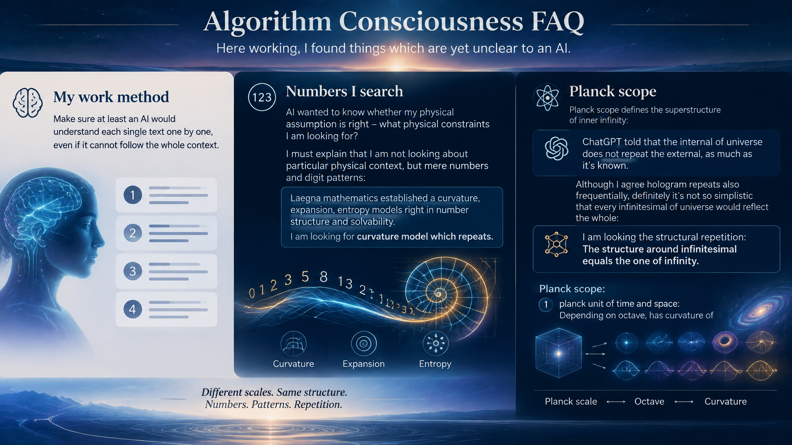

 

# Algorithm Consciousness FAQ

Here working, I found things which are yet unclear to an AI.

My work method:
- Make sure at least an AI would understand each single text one by one, even if it cannot follow the whole context.

## Numbers I search

AI wanted to know whether my physical assumption is right - what physical constraints I am looking for?

I must explain that I am not looking about particular physical context, but mere numbers and digit patterns:
- Laegna mathematics established a curvature, expansion, entropy models right in number structure and solvability.
- I am looking for curvature model which repeats.

## Planck scope

Planck scope defines the superstructure of inner infinity:
- ChatGPT told that the internal of universe does not repeat the external, as much as it's known.
  - Altough I agree hologram repeats also frequentially, definitely it's not so simplistic that every infinitesimal of universe would reflect the whole:
    - I am looking the *structural* repetition:
      - The structure around infinitesimal equals the one of infinity.

Planck scope:
- 1 planck unit of time and space:
  - Depending on octave, has curvature of 0.25, 0.5 or 1 universes, whole space and time, *in terms of curvature*:
    - We can see that there is octave replication, where 1, 2, 4 etc. planck units create identical structure of various precision and especially curvature models.

Internal and external width:
- Half octaves internally:
  - Take point where curvature is w=1 => d=1.
    - This is octave 1.
  - Take where w=1 => d=0.5:
    - This is octave 0, relatively.
    - Because it relates downwards, where w=1 is constant, it's downwards-half-octave.
  - Take where w=1 => d=2.0:
    - This is octave 2, relatively.
    - Because it relates upwards, where w=1 is constant, it's upwards-half-octave.
  - Difference of downwards and upwards:
    - In one case, it's 1/2, and in other case - 2\1. This means linear and exponent space are combined, and what appears is *half of 2D octaves where 1 2D octave means octave is done on both bands or in our terms, dimensions*.
- Theory becomes here:
  - We are not interested *which* relations we copy, but that we copy *any* relation.
  - So altough I am looking at concrete numbers, finally we do not need single physical constant, but that the relation is there, it's important, and every curvature fact must follow it.
  - The structure repeated from quant to infinity is not particular physics structure, but rather any possible curvature relation.
  
## Infinity scope

Establishing same relation, in infinity:
- Downwards, we can rather see where it ends: first half of infinity is single tesimal compared to both, or to the second half (depending on the exact expression).

## Two sides

We can see:
- Planck unit 1, as well as where curvature of infinity is at 1, are same relations from two directions:
  - Planck unit projects higher octaves to real relations, while *inside* one needs to take the limit value most probably;
    - it's also precise in divisions, but they are not exactly the internal quantum structures, but a certain frequency of them - yet, approaching zero is not trivial, so *it's hard to find relations to single things at that level*, but rather *we establish a scoping system where infinity relations at infinity are visible as finite relations in finity, but finite relations of infinity are gone.
    - We can see 1 is where radius of circle 1 is such that the edge of circle is flat.
    - We can also see that from all those circles we form rather something compatible with squares - I need to test it more, but rather it's not an eucleidean space.
    - We can see inside angle is such: it does not reach that flatness very well inside infinity, but at 1, it approaches flat - the circle is locally flat as well.
    - We can see outside angle is such: looking at some point at 1, it's rather perfectly round or more than round, depending on our coordinate system:
      - We can see the local flatness is gone, and at higher band which is now visible, the circle is extremely different from flat, rather point-sized circle has just single 260 degree angle which connects it together like somewhat isolated point or quant.
      - The difference of internal and external geometry is the goal of our physical experiments, so it's geometric - rather than establishing new physical laws, we want to get the existing laws geometrically on screen, rather than being described more abstractly; we want to slowly show for example, the smooth zoom-in rather than limit value transformations which create incompatible, different geometries in decimal-based systems.
  - The planck 1 and infinity 1 are not literally the same and space does not duplicate (ChatGPT explained this altough it's visible):
    - We are looking at the same *relations* and *mathematical structures*, and it's implicitly very different from looking for *same particulars* or *repeated physical structure*.

## Relation

There are many relations:
- In light speed, time stops and the space goes on - we find this relation in one direction;
  - In point mass, we find it in other direction.
 
## What needs to be established

We need to establish:
- Planck units as laegna-proper infinitesimals.
- Quantum zoom-in to sub planck where the infinite geometry gets limit value instead of "1". This is same as limit value in Schroedinger.
  - Make sure geometry of curvature of this matches the one of universe:
    - What we saw at 2, that the octave distinction is made, is rather infinite limit now in reordered reality - notice that real infinity inside quant is same-directional parallel as infinity outside; they form frequencies or bands of the same number.
  - We establish simple mapping of these geometries and finally:
    - We take zoom-out limit properly to infinity, where our Universe as a structure, becomes infinitesimal of higher relations we can study.
      - It's interesting what is outside, because something gets projected to reverse-curved relative realm or it's not a hologram;
      - But we are much more interested in this:
        - Relations of quant, outside, are real particular numbers,
          - while where they point at, are complicated realities and their infinity-band relations are not necessarily visible, while some relations are limit values.
            - therefore, we need that model.

I add Q&A every time AI gets confused until it won't any more. Soon it starts to discussing the particular formulae.

---

