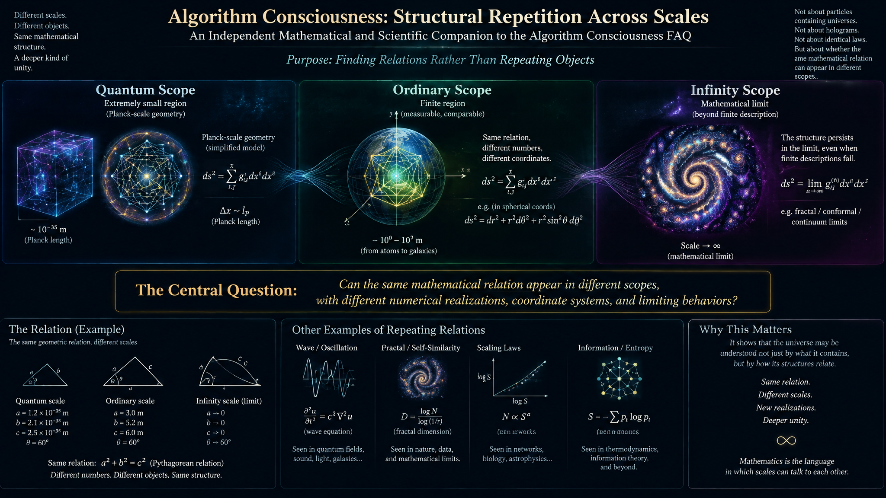

# Algorithm Consciousness: Structural Repetition Across Scales

## An Independent Mathematical and Scientific Companion to the Algorithm Consciousness FAQ

## 1. Purpose: Finding Relations Rather Than Repeating Objects

The central problem is whether a mathematical structure can be reproduced across radically different scales without requiring the objects that exhibit the structure to be physically identical.

Consider three scopes:

- **Quantum scope:** an extremely small region, approached through a model of Planck-scale geometry.
- **Ordinary scope:** a finite region in which distances, angles, and physical measurements can be compared.
- **Infinity scope:** a mathematical limit in which ordinary finite descriptions cease to represent the full structure directly.

The question is not whether a quantum particle literally contains a universe, whether the universe is a hologram, or whether every physical law must be identical at every scale.

Instead, the question is:

**Can the same mathematical relation appear in different scopes, with different numerical realizations, coordinate systems, and limiting behaviors?**

This question is meaningful in mathematics independently of whether a proposed model describes the actual physical universe.

For example, the relation

$$
d = 2w
$$

can hold for a microscopic model, a macroscopic model, and an abstract limiting model without requiring their dimensions to have the same physical units.

The relation remains invariant while its realization changes.

This is the starting point for the Laegna investigation: identify the relations that survive changes of scale, determine how their numerical representations change, and establish whether a common transformation can reproduce them.

## 2. Three Layers of the Investigation

It is important to distinguish three layers of reasoning.

### 2.1. Numerical Structure

The first layer concerns numbers themselves:

- Doubling and halving.
- Octaves and half-octaves.
- Repeated digit structures.
- Ratios between width and depth.
- Curvature parameters.
- Finite values that approach limiting values.

At this layer, we do not need to decide whether a number represents a particle, a light-year, a Planck length, or an abstract coordinate.

We need to determine the mathematical relations between the numbers.

### 2.2. Geometric Realization

The second layer assigns geometric meaning to the numerical structure.

For example, let $w$ denote a width parameter and $d$ a depth parameter. The model may investigate the following configurations:

$$
(w,d)\in\{(1,0.5),(1,1),(1,2)\}.
$$

These configurations share a constant width while their depth changes by factors of two.

The resulting question is whether the three configurations represent different resolutions of one geometric relation, different geometric states, or different coordinate descriptions of the same underlying structure.

That distinction must be determined by the transformation rules, not assumed from the numbers alone.

### 2.3. Physical Interpretation

The third layer asks whether the mathematical model corresponds to physical reality.

This requires additional definitions and, eventually, comparison with established physical theory or experimental observations.

A numerical relation can be mathematically valid without being a physical law. Conversely, a useful physical law may have different mathematical representations in different coordinate systems.

The investigation should therefore proceed in this order:

1. Establish the numerical relation.
2. Define its geometric interpretation.
3. Construct transformations between scales.
4. Compare the resulting model with physical theory.
5. Determine which interpretations remain justified.

This ordering prevents an unresolved physical question from obstructing a mathematical investigation that can already proceed.

## 3. The Laegna Octave Model

### 3.1. Octaves as Multiplicative Transformations

An octave can be represented as multiplication or division by two.

For a positive quantity $x$, define the scale transformation

$$
T_n(x)=2^n x,\qquad n\in\mathbb{Z}.
$$

The integer $n$ identifies the number of octave transformations.

For example,

$$
\frac{1}{2}\rightarrow 1\rightarrow 2\rightarrow 4\rightarrow 8.
$$

The inverse transformation is

$$
T_{-n}(x)=2^{-n}x.
$$

If the scale is described logarithmically, then

$$
s=\log_2 x
$$

turns multiplication by two into addition by one:

$$
\log_2(2x)=\log_2 x+1.
$$

Thus, an octave sequence that is multiplicative in ordinary coordinates becomes a uniform sequence in logarithmic coordinates.

This is a standard mathematical property, not a special physical assumption.

The Laegna question is whether the same transformation can organize curvature and geometric relations, rather than merely the magnitudes of quantities.

### 3.2. Width and Depth

Suppose width remains fixed:

$$
w=1.
$$

Let depth follow the octave sequence

$$
d_n=2^n.
$$

Then

$$
d_{-1}=\frac{1}{2},\qquad d_0=1,\qquad d_1=2.
$$

These three values reproduce the configurations under investigation.

The important feature is that the same numerical transformation can be applied repeatedly.

However, we must distinguish a depth coordinate from a curvature measurement. A change in depth does not automatically imply a corresponding change in physical curvature.

To establish that connection, the model needs a function such as

$$
K=F(w,d),
$$

where $K$ is a precisely defined curvature quantity.

The function $F$ is not yet specified by the three width-depth pairs. Determining it is part of the research.

### 3.3. Half-Octaves and Two-Dimensional Scaling

A half-octave corresponds to multiplication by

$$
2^{1/2}=\sqrt{2}.
$$

Consequently, a half-octave sequence can be represented as

$$
1,\sqrt{2},2,2\sqrt{2},4,\ldots
$$

When two independent dimensions are scaled together, the result depends on whether the quantities represent lengths, areas, volumes, or something else.

For an isotropic transformation in $D$ dimensions, scaling every length by $\lambda$ multiplies a $D$-dimensional volume by

$$
V'=\lambda^D V.
$$

In two dimensions, doubling both linear dimensions multiplies the area by four.

This gives a useful distinction:

- One octave in a linear coordinate means a factor of two.
- One octave applied to two independent linear dimensions produces a factor of four in area.
- A half-octave applied to both linear dimensions produces a factor of two in area.

The Laegna convention of treating two bands or dimensions together can therefore be formalized, provided the dimensional meaning of each quantity is specified.

The distinction between linear and exponential representations is especially important here. A factor of two in one coordinate is not equivalent to a factor of two in every derived geometric measurement.

## 4. Structural Repetition and Scale Invariance

In mathematics, scale invariance describes properties that remain unchanged under a specified change of scale. Self-similarity is a related concept in which scaled portions reproduce the structure of a larger object.

These ideas appear in fractal geometry, critical phenomena, and multiscale models. They provide established mathematical points of comparison for Laegna's proposed structural repetition.

### 4.1. Exact Repetition

Suppose a geometric object is described by a state $G$ and a scaling transformation $S_\lambda$.

Exact self-similarity would mean that the transformed object reproduces the same structure, up to the specified scaling:

$$
G\sim S_\lambda(G).
$$

The symbol $\sim$ means equivalence under the chosen definition, not literal equality of all measurements.

For Laegna, the relevant equivalence may concern curvature ratios, width-depth relations, angle patterns, or digit structures.

The equivalence relation must be chosen explicitly.

### 4.2. Repetition of Relations Rather Than Objects

A more general possibility is that two geometries are different in their physical realization but preserve the same relation.

Let

$$
G_1=(w_1,d_1,K_1,\ldots)
$$

and

$$
G_2=(w_2,d_2,K_2,\ldots).
$$

A relation $R$ is structurally preserved if

$$
R(G_1)=R(G_2)
$$

under the selected mapping.

For example, the width-depth ratio might be invariant:

$$
\frac{d_1}{w_1}=\frac{d_2}{w_2}.
$$

Alternatively, the ratio may transform predictably:

$$
\frac{d_2}{w_2}=2^n\frac{d_1}{w_1}.
$$

Both are legitimate mathematical patterns. They describe different forms of structural correspondence.

The important question is which relation the Laegna model actually preserves.

### 4.3. Discrete Versus Continuous Scale Invariance

An octave model naturally defines discrete scaling by powers of two:

$$
\lambda_n=2^n.
$$

Continuous scale invariance would require a corresponding relation for arbitrary positive $\lambda$, not only powers of two.

This difference matters because a model may reproduce itself at octave intervals while behaving differently between those intervals.

A continuous zoom model therefore needs an interpolation rule, such as

$$
G(\lambda)=\Phi_\lambda(G_0),
$$

where $\Phi_\lambda$ describes how the geometry changes with scale.

The rule must also specify whether the transformations compose consistently:

$$
\Phi_{\lambda_1}\circ\Phi_{\lambda_2}
=
\Phi_{\lambda_1\lambda_2}.
$$

If this property holds, changing scale in two successive steps gives the same result as applying their combined scale transformation.

This is a useful mathematical test for whether a proposed octave structure can be extended to a coherent continuous model.

## 5. Planck Scope: An Infinitesimal Model

The Planck length is conventionally defined from the constants $G$, $\hbar$, and $c$:

$$
\ell_P=\sqrt{\frac{\hbar G}{c^3}}.
$$

Its approximate value is

$$
\ell_P\approx1.616\times10^{-35}\text{ m}.
$$

The Planck time is correspondingly

$$
t_P=\frac{\ell_P}{c}.
$$

These are established definitions of natural units. Their existence does not prove that spacetime is made of indivisible Planck-sized units, or that the geometry at this scale is known to follow a particular repeating pattern.

### 5.1. The Laegna Proposal

The Laegna investigation assigns a structural role to the Planck scope.

The proposed idea is that a Planck-scale reference can serve as an infinitesimal coordinate in a mathematical system whose larger-scale relations can be investigated through octave transformations.

The intended question is not merely how small the Planck length is.

It is whether the geometry surrounding the chosen infinitesimal has a relational structure corresponding to the geometry surrounding a finite or infinite reference elsewhere in the model.

To formalize this, define an abstract geometric state

$$
G_P(\epsilon),
$$

where $\epsilon$ represents the selected infinitesimal scale.

The state might contain width, depth, curvature, angles, and a scale index. Its exact components depend on the model.

We then seek a transformation

$$
\Phi_{\epsilon\rightarrow L}
$$

that maps the Planck-scope state to a state associated with a larger scale $L$.

The structural-repetition hypothesis becomes

$$
R\!\left(G_P(\epsilon)\right)
=
R\!\left(\Phi_{\epsilon\rightarrow L}(G_P(\epsilon))\right),
$$

for a specified relation $R$.

This equation expresses the research objective without assuming that the physical objects at the two scales are identical.

### 5.2. What Does One Planck Unit Represent?

A distinction is needed between three meanings of the value one:

1. **Unit value:** a quantity equals one in the selected unit system.
2. **Reference value:** a quantity is normalized to one for comparison.
3. **Geometric value:** a quantity has a specific geometric meaning, such as a normalized radius or curvature.

These meanings can coincide in a model, but they are not interchangeable by default.

In particular, setting a Planck-scale coordinate to one does not establish that its curvature is one, that it contains one complete universe, or that it represents a minimum physical length.

Those are additional model assumptions that require explicit definitions.

### 5.3. Octave Replication at the Planck Scope

Suppose the model assigns different geometric resolutions to the sequence

$$
\epsilon,\quad 2\epsilon,\quad4\epsilon,\quad8\epsilon.
$$

Each member of the sequence can be used to calculate the same set of dimensionless geometric descriptors.

For example,

$$
q=\frac{d}{w}
$$

is dimensionless if $d$ and $w$ are both lengths.

If the ratio $q$ follows the same pattern at every octave, the model has established a form of relational invariance.

If $q$ changes systematically, that change may still be reproducible through a scaling law.

The task is to calculate which case occurs, not to assume that all octaves have identical geometry.

## 6. Infinity Scope: Finite Coordinates and Limiting Values

Infinity is not an ordinary finite coordinate. A mathematical model must specify how it approaches infinity and which quantities remain meaningful in that limit.

This is especially important when the model describes a finite geometric state that changes as its scale parameter grows.

Let $L$ be a scale parameter and let

$$
G(L)
$$

represent the geometry at that scale.

The infinity-scope geometry is then investigated through

$$
G_\infty=\lim_{L\rightarrow\infty}G(L),
$$

provided the limit exists in the chosen mathematical sense.

The limit might be finite, infinite, degenerate, or nonexistent.

It may also depend on which geometric quantities are held fixed during the process.

### 6.1. The Significance of the Approach

Two functions can have the same limit but behave differently on the way to it.

For example,

$$
f(L)=\frac{L}{L+1}
$$

and

$$
g(L)=1-\frac{1}{(L+1)^2}
$$

both approach one as $L$ tends to infinity.

However, their rates of approach differ.

If the Laegna model is concerned with a continuous zoom rather than merely a final limiting value, the rate and structure of convergence matter.

We should therefore investigate both:

- The limiting geometry.
- The family of finite geometries that approaches it.

This distinction is central to making infinity scope computationally useful.

### 6.2. A Finite Model of an Infinite Relation

A useful possibility is that a relation which is difficult to inspect directly at infinity can be represented by finite quantities.

Suppose

$$
R(L)\longrightarrow R_\infty.
$$

If the model provides a transformation that preserves the relevant relational structure, finite values of $R(L)$ can be studied as approximations to the limiting relation.

However, the finite approximation does not automatically preserve every property of the limiting object.

For example, a sequence of circles may approach a straight line locally under a particular scaling, while their global geometry remains circular.

The distinction between local and global behavior is therefore essential.

## 7. Local Flatness and Global Curvature

One of the most useful connections is to differential geometry.

A sufficiently small region of a smooth curved surface can resemble a flat plane, even though the entire surface is curved.

For a sphere of radius $R$, a geodesic circle of radius $r$ has circumference

$$
C(r)=2\pi R\sin\left(\frac{r}{R}\right).
$$

For $r\ll R$, a Taylor expansion gives

$$
C(r)
=
2\pi r
\left[
1-\frac{r^2}{6R^2}
+O\!\left(\frac{r^4}{R^4}\right)
\right].
$$

Thus, at small scales,

$$
C(r)\approx2\pi r.
$$

The geometry becomes locally close to Euclidean, although the sphere has nonzero curvature.

The Gaussian curvature of the sphere is

$$
K=\frac{1}{R^2}.
$$

This gives an important distinction for the Laegna model:

**A geometric structure can change its visible appearance with scale without the underlying curvature relation simply disappearing.**

The observed geometry depends on the scale of inspection and on the quantities being measured.

### 7.1. Flatness as a Relation

Suppose the model uses a normalized circumference ratio:

$$
F(r)=\frac{C(r)}{2\pi r}.
$$

For the sphere,

$$
F(r)=\frac{R}{r}\sin\left(\frac{r}{R}\right).
$$

As $r/R\rightarrow0$,

$$
F(r)\rightarrow1.
$$

The value one represents local Euclidean behavior under this particular measurement.

It does not mean that the whole sphere has become flat.

This is a concrete example of a finite geometric quantity approaching a limiting value while the global object retains a different structure.

### 7.2. Curvature Must Be Defined Operationally

The FAQ uses width $w$, depth $d$, and curvature together. These quantities can be related, but a curvature function must be specified before the relation can be calculated uniquely.

Possible choices include:

- Gaussian curvature for a surface.
- Scalar curvature for a higher-dimensional geometry.
- Geodesic circumference ratios.
- Angle deficits around geometric loops.
- A model-specific dimensionless curvature parameter.

These quantities are not interchangeable.

If $w$ and $d$ are lengths, then $d/w$ is dimensionless. By contrast, Gaussian curvature has units of inverse length squared.

A dimensionless curvature parameter might therefore take a form such as

$$
\kappa=K w^2,
$$

where $K$ is Gaussian curvature and $w$ is a specified characteristic length.

This is only an example of a possible definition, not an established identification of the Laegna curvature parameter.

The next step is to determine which definition reproduces the intended octave relations.

## 8. Internal and External Geometry

The Laegna proposal distinguishes between two directions of investigation:

- Moving inward toward an infinitesimal scope.
- Moving outward toward an infinite scope.

These can be represented mathematically as two different limiting processes.

Let $G(s)$ be a family of geometric states indexed by a scale coordinate $s$.

An inward limit might be

$$
G_{\mathrm{in}}
=
\lim_{s\rightarrow s_{\min}}G(s),
$$

while an outward limit might be

$$
G_{\mathrm{out}}
=
\lim_{s\rightarrow s_{\max}}G(s).
$$

Here $s_{\min}$ and $s_{\max}$ need not be ordinary numerical endpoints. They can represent limiting regimes.

The important point is that the limits need not produce the same geometry.

Even when the same relation is preserved, the coordinate descriptions and visible structures may differ.

### 8.1. Why Reversal Is Not Automatically Symmetry

Suppose a model has a transformation $T$ that maps an inward description to an outward description.

For a true involution, one would require

$$
T(T(G))=G.
$$

But an inward-to-outward transformation need not be an involution.

It might preserve a ratio, reverse an orientation, exchange width and depth, or change the sign of a curvature parameter.

These possibilities should be distinguished.

For example, exchanging width and depth gives

$$
T(w,d)=(d,w).
$$

Applying the transformation twice restores the original pair.

However, if the transformation also rescales the coordinates, its second application might not restore the original state.

This provides a direct mathematical test for whether the internal and external scopes are exact reversals or only structurally related.

### 8.2. A Common Structure Without a Common Coordinate System

Two geometries can share the same invariant relations while using different coordinates.

For example, a circle can be represented by Cartesian coordinates or polar coordinates. The equations differ, but they describe the same geometry when the coordinate transformation is applied correctly.

More generally, an invariant relation can survive a change of representation.

The Laegna model can use this idea to separate:

- The geometry itself.
- The coordinate system used to describe it.
- The scale transformation used to compare it with another geometry.

This is a more precise formulation of structural repetition than requiring the numerical coordinates to remain identical.

## 9. The Significance of the Proposed 260-Degree Angle

The FAQ describes an external geometry in which a point-like structure is associated with an angle of approximately 260 degrees.

This is an interesting model-specific claim, but it requires a definition before it can be compared with ordinary geometry.

In Euclidean geometry, a full turn around a point is 360 degrees. A cone, for example, can have an angular deficit: the angle around its apex in the intrinsic surface geometry is less than a full turn.

A deficit of 100 degrees would correspond to a remaining angular measure of 260 degrees under that particular construction.

But an angle of 260 degrees does not by itself establish a new geometry. Its interpretation depends on what is being measured:

- An interior angle.
- An exterior or directed angle.
- A total angular measure around a point.
- A coordinate angle in a transformed representation.
- An angular measure associated with a proposed limiting geometry.

The Laegna investigation should specify which meaning applies.

If 260 degrees is a calculated consequence of the width-depth transformation, the calculation should be shown. If it is a proposed parameter, it should be treated as an input until derived independently.

This distinction makes the claim testable without discarding it prematurely.

## 10. Connections to Renormalization and Effective Descriptions

Renormalization provides another useful mathematical comparison.

In statistical physics and quantum field theory, renormalization-group methods study how descriptions of a system change with scale. The aim is often to identify which properties remain important and which change as the resolution changes.

### 10.1. A Scale-Dependent State

Let $G_n$ represent the geometric state at octave $n$.

A general scale transformation can be written as

$$
G_{n+1}=\mathcal{R}(G_n),
$$

where $\mathcal{R}$ is a transformation that maps one scale description to another.

If the same transformation is applied repeatedly,

$$
G_n=\mathcal{R}^n(G_0).
$$

A fixed point satisfies

$$
\mathcal{R}(G_*)=G_*.
$$

A fixed point is not necessarily a physical object. It is a state unchanged by the specified transformation.

In the Laegna context, such a state could represent an invariant geometric relation under octave scaling.

Alternatively, the model might have a cycle:

$$
G_0\rightarrow G_1\rightarrow G_2\rightarrow G_0.
$$

This would represent repeating structure without requiring a single fixed geometry.

### 10.2. Relevant and Irrelevant Changes

A scale transformation may preserve some variables while suppressing others.

For instance, a normalized ratio may approach a constant as the scale grows, while a dimensional quantity increases without bound.

This means that the limiting model can retain a structural property while losing direct information about the finite realization.

That is closely related to the distinction in renormalization between scale-dependent details and properties that dominate the large-scale description.

The analogy is methodological. It does not establish that the Laegna geometry obeys a particular physical renormalization-group equation.

### 10.3. What the Connection Contributes

Renormalization suggests three useful questions:

1. Which geometric quantities are invariant under the octave transformation?
2. Which quantities change predictably?
3. Does repeated transformation approach a fixed point, a cycle, or a different limiting state?

Answering these questions would give the proposed scale-repetition model a precise mathematical structure.

## 11. Connection to Quantum Mechanics and the Schrödinger Equation

The FAQ proposes that zooming inward beyond the Planck scope should produce a limiting geometry rather than simply setting the scale to one.

This can be compared conceptually with the role of limiting procedures in quantum mechanics, but the mathematical connection must be specified carefully.

The Schrödinger equation is

$$
i\hbar\frac{\partial\psi}{\partial t}
=
\hat{H}\psi.
$$

Its wavefunction $\psi$ describes a quantum state within a specified quantum-mechanical model.

A limit in the wavefunction, its parameters, or the underlying operator may produce a different mathematical regime. However, the equation itself does not imply that a geometric infinity must occur inside a quantum.

To connect the Laegna construction to quantum mechanics, one would need to define a mapping between geometric variables and quantum quantities.

For example, a model could investigate whether a scale-dependent geometric parameter is related to a characteristic wavelength, an energy scale, or an effective operator.

But such a relation must be derived or explicitly proposed.

### 11.1. Limiting Values Are Not Necessarily Physical States

Consider

$$
f(x)=\frac{x}{1+x}.
$$

Then

$$
\lim_{x\rightarrow\infty}f(x)=1.
$$

The value one is the limit of the function, but it is not attained at any finite positive $x$.

The limiting value can still organize a finite family of states.

This is the mathematical idea relevant to the Laegna proposal: a limiting geometric value can serve as a reference for comparing finite configurations.

The existence of such a limit does not imply that the limit corresponds to a physically realized state.

### 11.2. What Would Establish the Connection?

A more precise model would need to specify:

- The geometric variable being mapped.
- The quantum quantity associated with that variable.
- The transformation between the two descriptions.
- The conditions under which the mapping is valid.
- Whether the correspondence is exact, approximate, or only an analogy.

Until then, the connection is a promising direction of mathematical investigation rather than an established quantum-physical result.

## 12. Light Speed, Point Mass, and Opposite Relational Directions

The FAQ also identifies two apparently opposite relations:

- At light speed, the relationship between time and spatial propagation changes.
- At a point mass, the geometry of space and time is affected by gravity.

These are useful prompts for comparing different descriptions of spacetime, but they must be formulated precisely.

### 12.1. Light Propagation

In special relativity, the spacetime interval is

$$
ds^2=-c^2dt^2+dx^2+dy^2+dz^2
$$

under the chosen metric-signature convention.

For a lightlike trajectory,

$$
ds^2=0.
$$

This gives, in a suitable inertial coordinate system,

$$
c^2dt^2=dx^2+dy^2+dz^2.
$$

This is the precise relationship between temporal and spatial coordinate differences along a lightlike trajectory.

It does not mean that an ordinary observer sees time literally stop for a photon. There is no inertial rest frame for a photon.

### 12.2. Gravitational Geometry

In general relativity, mass-energy influences spacetime geometry through Einstein's field equations:

$$
G_{\mu\nu}+\Lambda g_{\mu\nu}
=
\frac{8\pi G}{c^4}T_{\mu\nu}.
$$

The geometry and the distribution of mass-energy are related through this equation.

A point mass is an idealization that requires care. In the Schwarzschild solution, for example, the exterior geometry describes the vacuum region outside a spherically symmetric mass. The central singularity is not an ordinary, physically resolved point of matter.

### 12.3. A Possible Structural Comparison

The Laegna model might investigate whether the lightlike relation and the gravitational relation can be expressed through a common abstract structure.

To do so, it would need to define the corresponding variables and identify a transformation that relates the two.

The shared mathematical form might concern a constraint, a limiting relation, a ratio, or a geometric invariant.

It should not be assumed that the two physical situations are identical or that one can be derived from the other merely because both involve spacetime.

The useful question is whether a common mathematical representation can be constructed and what it would explain.

## 13. Structural Repetition Versus the Holographic Principle

The holographic principle is another possible comparison, but it is not synonymous with self-similarity.

The general holographic idea concerns relationships between descriptions of a system in different numbers of dimensions. In particular theoretical settings, a gravitational theory in a higher-dimensional space can have a related description in a lower-dimensional theory.

This does not imply that every small region physically contains a complete copy of the universe.

The Laegna proposal asks a different question: whether geometric relations recur across scales, including between infinitesimal and infinite limiting descriptions.

These ideas could potentially be compared, but their mathematical requirements differ.

A holographic correspondence needs a mapping between descriptions of different dimensionality. Structural scale repetition needs a mapping that preserves the selected relations across scales.

Neither mapping follows automatically from the other.

The distinction is valuable because it permits the Laegna model to be investigated without adopting a literal holographic interpretation.

## 14. One Mathematical Structure, Different Physical Scopes

The central proposal can be formulated using three families of states:

$$
G_P,\qquad G_F,\qquad G_\infty,
$$

representing Planck, finite, and infinite scopes.

Let $R$ be a relation defined on these states.

The structural-repetition hypothesis is that suitable mappings exist such that

$$
R(G_P)
=
R\!\left(\Phi_{P\rightarrow F}(G_P)\right)
$$

and

$$
R(G_F)
=
R\!\left(\Phi_{F\rightarrow\infty}(G_F)\right),
$$

where the equalities apply to the selected relation, not necessarily to the complete geometric states.

This is deliberately more general than asserting that the three geometries are identical.

The mappings may change dimensional quantities, coordinate descriptions, and limiting behavior while preserving a specified structural property.

The research challenge is to identify the appropriate relation $R$, define the mappings $\Phi$, and determine the conditions under which these equations hold.

### 14.1. What Counts as a Successful Result?

A successful result could take several forms:

- An exact invariant that remains unchanged across scales.
- A predictable transformation law for a curvature parameter.
- A family of geometric states that approaches a common limit.
- A repeating cycle under octave transformations.
- A mapping that preserves one relation while reversing another.
- A counterexample showing that a proposed relation does not survive a particular transformation.

The last possibility is also useful. A model becomes more informative when its conditions of validity are known.

## 15. Algorithmic Consciousness: The Computational Layer

The name *Algorithm Consciousness* introduces an additional question: how can an algorithm represent, compare, and reason about relations across scales?

An algorithm can store a geometric state, apply transformations, compare invariants, and detect patterns. These operations are enough to investigate the mathematical proposal computationally.

They do not, by themselves, establish that the algorithm possesses subjective consciousness.

The distinction between algorithmic representation and phenomenal consciousness should remain explicit.

### 15.1. Representing a Geometric State

A minimal state might be represented as

$$
G=(w,d,K,n,\mathcal{C}),
$$

where:

- $w$ is a width parameter.
- $d$ is a depth parameter.
- $K$ is a defined curvature quantity.
- $n$ is an octave index.
- $\mathcal{C}$ contains additional model constraints.

An algorithm can transform this state, calculate derived quantities, and compare it with states from other scales.

### 15.2. Searching for Invariants

Suppose the model defines a relation

$$
R(G)=\frac{d}{w}.
$$

The algorithm can generate octave-scaled states and test whether $R$ remains constant.

Alternatively, if the expected relation is

$$
R(G_{n+1})=2R(G_n),
$$

the algorithm can test that transformation law.

A more complex implementation could examine several candidate relations simultaneously.

The result is a computational search for structural repetition.

### 15.3. Symbolic Reasoning and Numerical Reasoning

Numerical calculations can reveal patterns, but symbolic calculations can establish whether a relation holds generally under stated assumptions.

For example, numerical sampling may suggest that

$$
f(2x)=2f(x).
$$

A symbolic calculation can then determine whether this identity holds for the entire domain or only for selected values.

This distinction is particularly important when a model uses octaves, logarithms, and limiting values. A pattern that appears at integer octaves might fail between them.

### 15.4. What Would Consciousness Add?

An algorithm that identifies invariants has demonstrated a computational capability.

To establish a stronger claim about consciousness, additional criteria would be necessary. These might concern subjective experience, self-modeling, integrated information, or other explicitly defined theories of consciousness.

The geometry model alone cannot settle that question.

Its contribution is more specific: it offers a potential domain in which an algorithm can reason about scale, representation, transformation, and the preservation of relations.

## 16. A Concrete Mathematical Research Programme

The investigation can now be divided into a sequence of tasks.

### Task 1: Define the State Variables

Specify what $w$, $d$, and $K$ mean.

If width and depth are lengths, define their coordinate system and units. If they are normalized geometric parameters, state the normalization.

If the model uses a different notion of curvature from conventional differential geometry, define it explicitly.

### Task 2: Establish the Octave Transformations

Write the transformation rules for each variable.

For example,

$$
w_{n+1}=2^a w_n,
\qquad
d_{n+1}=2^b d_n.
$$

The exponents $a$ and $b$ determine how the two quantities scale.

Keeping them separate allows the model to represent isotropic scaling, anisotropic scaling, or a constant-width transformation.

### Task 3: Define the Curvature Relation

Specify a function such as

$$
K_n=F(w_n,d_n).
$$

Then calculate the effect of the octave transformation:

$$
K_{n+1}=F(w_{n+1},d_{n+1}).
$$

The objective is to determine whether curvature is invariant, scales by a power law, or follows a different transformation.

### Task 4: Construct a Continuous Interpolation

Extend the integer octave index to a real scale parameter $s$.

For example,

$$
w(s)=w_0\,2^{as},
\qquad
d(s)=d_0\,2^{bs}.
$$

This provides a continuous family of states, assuming the model chooses these scaling laws.

The corresponding curvature becomes

$$
K(s)=F(w(s),d(s)).
$$

This is where the proposed continuous zoom can be calculated rather than described only verbally.

### Task 5: Analyze the Inward Limit

Evaluate

$$
\lim_{s\rightarrow-\infty}G(s),
$$

or the appropriate finite endpoint if the model uses a different domain.

Determine which variables converge, diverge, or become undefined.

A divergent coordinate does not necessarily imply divergent curvature, because curvature may depend on ratios or products of coordinates.

### Task 6: Analyze the Outward Limit

Evaluate

$$
\lim_{s\rightarrow+\infty}G(s).
$$

Compare the limiting behavior with the inward limit.

The two limits may share invariants without sharing numerical values or geometric realizations.

### Task 7: Test the Mapping Between Limits

Define a mapping between the inward and outward descriptions.

Determine which properties it preserves and whether it is invertible.

If it reverses curvature, exchanges width and depth, or changes the angular measure, derive those transformations explicitly.

### Task 8: Compare with Established Geometries

Test the model against standard geometric examples:

- Euclidean space.
- Spherical geometry.
- Hyperbolic geometry.
- Cone geometry and angular deficits.
- Scale-invariant and self-similar structures.

These comparisons can identify which parts of the proposal reproduce established mathematics and which parts introduce new assumptions.

### Task 9: Identify Physical Implications

Only after the mathematical construction is explicit should the model be compared with quantum mechanics, general relativity, or cosmology.

A physically significant result would require a correspondence with established variables or a prediction that differs from existing models in a testable way.

## 17. A Minimal Computational Experiment

The following Python example implements the basic octave scaling of width and depth. It deliberately does not assume a physical curvature formula.

```python
def state(octave, w0=1.0, d0=1.0, a=0.0, b=1.0):
    w = w0 * 2.0 ** (a * octave)
    d = d0 * 2.0 ** (b * octave)

    return {
        "octave": octave,
        "width": w,
        "depth": d,
        "ratio": d / w,
    }


for n in range(-3, 4):
    print(state(n))
```

With $a=0$ and $b=1$, width remains constant while depth doubles at every octave.

To investigate the curvature hypothesis, one would add a justified function $F(w,d)$, calculate the corresponding curvature values, and test the desired invariance or transformation rule.

For a continuous model, the octave variable can be replaced by any real number. This makes it possible to inspect the intermediate geometries between the discrete octave states.

A more advanced implementation could compare the inward and outward limits numerically, detect fixed points, and measure how closely two geometric states preserve the same relation.

The computational output would be a reproducible record of the model's behavior rather than an interpretation imposed on the results.

## 18. What the Model Must Not Assume

Several distinctions are necessary for the investigation to remain mathematically clear.

**A numerical pattern is not automatically a physical law.** A repeated ratio may be mathematically exact without describing nature.

**A Planck unit is not automatically a physical atom of spacetime.** Planck-scale behavior remains an open research subject, and the Planck length's definition does not establish a unique microscopic geometry.

**A limit is not automatically a realized state.** A mathematical function may approach a value without ever attaining it.

**A change in coordinates is not automatically a change in geometry.** Different representations can describe the same geometric object.

**A repeated relation is not automatically a repeated object.** Structural equivalence must be defined in terms of the properties being compared.

**An algorithm that detects structure is not automatically conscious.** Computational competence and subjective experience are distinct questions.

These distinctions do not diminish the investigation. They define what must be calculated to establish its results.

## 19. The Central Hypothesis

The most general formulation of the Laegna investigation is this:

A geometric relation may admit representations at several scales, including infinitesimal and infinite limiting regimes. These representations need not describe identical physical structures. Instead, a mapping may preserve selected relations while transforming coordinates, curvature parameters, and limiting behavior.

The proposed octave model supplies a candidate family of scale transformations.

The width-depth configurations provide initial numerical examples.

Differential geometry supplies precise definitions of curvature and local flatness. Scale invariance and renormalization provide mathematical frameworks for comparing structures at different resolutions. Quantum mechanics and general relativity supply possible physical domains for later investigation, without determining the result in advance.

The task is to construct the mappings, identify the invariants, calculate the limits, and establish which geometric properties are preserved.

The central question is therefore not simply whether the universe repeats itself.

It is:

**Which relations remain mathematically identifiable when the same geometric model is examined from the infinitesimal, finite, and infinite scopes, and what transformation law connects those descriptions?**

That question can be investigated systematically. Its answer may establish an exact mathematical correspondence, a useful approximation, a restricted family of invariants, or the limits of the proposed model.

Any of these outcomes would make the structure more precise and the next stage of research more productive.
