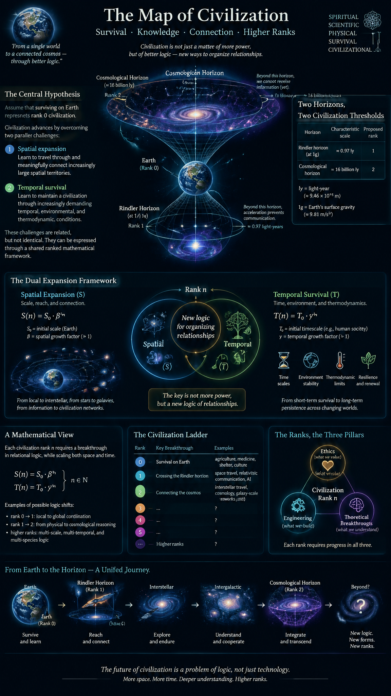

# Civilization Ranks: Ethics, Engineering, and Theoretical Breakthroughs

## 1. The Central Hypothesis

Assume that surviving on Earth represents **rank 0 civilization**.

Civilization advances by overcoming two parallel challenges:

- **Spatial expansion:** learning to travel through and meaningfully connect increasingly large spatial territories.
- **Temporal survival:** learning to maintain a civilization through increasingly demanding temporal, environmental, and thermodynamic conditions.

These challenges can be expressed through a shared ranked mathematical framework. The spatial and temporal problems are related, but they are not identical.

The central hypothesis is that each new rank requires a breakthrough in the logic used to organize relationships, rather than merely an increase in technological power.

## 2. Two Horizons, Two Civilization Thresholds

The proposed physical reference points are:

| Horizon | Characteristic scale | Proposed civilization rank |
|---|---:|---:|
| Rindler horizon at $1g$ | Approximately $0.97$ light-years | Rank 1 |
| Cosmological horizon | Approximately $16$ billion light-years | Rank 4 |

The first scale follows from the characteristic Rindler horizon distance:

$$
L_a = \frac{c^2}{a}.
$$

For an acceleration of $1g$, this gives approximately $0.97$ light-years.

The second scale represents a proposed cosmological horizon reference. Its precise physical interpretation depends on the cosmological model.

Within this civilization framework, the two scales represent different orders of spatial challenge:

- **Rank 1:** overcoming the first major horizon associated with sustained relativistic space travel.
- **Rank 4:** overcoming the vastly larger challenge of intergalactic or cosmological spatial reach.

These are proposed civilizational thresholds, not established physical transitions. Crossing a Rindler horizon is not equivalent to achieving interstellar travel, and a cosmological event horizon cannot necessarily be crossed outward by any technological civilization. The physical accessibility of each region must be considered separately.

## 3. Two Cooling Thresholds

The same ranked structure can be applied to temporal survival.

The hypothesis proposes two characteristic cooling thresholds:

- **Rank 1:** learning to survive and maintain a healthy civilization through the first relevant thermal or environmental transition.
- **Rank 4:** surviving a much more demanding thermal or thermodynamic transition associated with the second reference scale.

The horizon-temperature relationships provide a possible mathematical analogy.

For an idealized accelerated observer, the Unruh temperature is

$$
T_U = \frac{\hbar a}{2\pi c k_B}.
$$

For an idealized de Sitter cosmological horizon,

$$
T_{\mathrm{dS}} = \frac{\hbar H}{2\pi k_B}.
$$

Both temperatures can be expressed inversely in terms of their respective characteristic horizon lengths:

$$
T \propto \frac{1}{R}.
$$

However, these are horizon-associated temperatures, not two established cooling thresholds for living organisms or civilizations. Actual thermal survival depends on energy sources, heat transfer, environmental conditions, and the mechanisms by which a civilization maintains itself.

The proposed civilizational interpretation therefore requires additional definitions specifying what is cooling, which temperatures matter, and what constitutes successfully passing each threshold.

## 4. The Z–X–Y Civilization Model

The civilization ranks can be organized into three conceptual dimensions.

### Z — Earth civilization: the ethical breakthrough

**Rank 0 or 1**

Z represents the local, material civilization and its relationship with the Earth.

The central challenge is to establish the ethical and cooperative conditions needed for long-term survival.

This includes:

- Coordinating human activity without destroying the conditions that sustain civilization.
- Resolving conflicts over shared resources.
- Developing institutions and ethics that support cooperation across populations.
- Maintaining a healthy relationship between civilization and its planetary environment.

The defining breakthrough is **ethical coordination**.

A civilization can possess sophisticated tools while remaining unable to coordinate its actions in ways that ensure its long-term survival.

In this model, Z is the first major test: whether a civilization can meaningfully organize itself within the territory it already occupies.

### X — Local space civilization: the engineering breakthrough

**Rank 1 or 2**

X represents expansion beyond the immediate planetary environment.

The central challenge becomes engineering: how to travel, construct, communicate, and maintain reliable relationships across spatially separated locations.

This includes:

- Sustained space travel and life support.
- Energy and resource management across distance.
- Communication and coordination despite signal delays.
- Designing systems that remain functional when individual components are separated by enormous distances.

The defining breakthrough is **engineering coordination**.

At this level, merely connecting two points is insufficient. The civilization must establish reliable connections among many points while accounting for distance, travel time, energy requirements, and system failure.

### Y — Global space civilization: the theoretical breakthrough

**Rank 3 or 4**

Y represents the challenge of understanding and coordinating systems at an enormous spatial scale.

The central problem is no longer simply constructing individual connections. It is understanding the global structure of the network and determining which relationships make large-scale expansion possible.

This includes:

- Developing theories that predict large-scale spatial and temporal relationships.
- Understanding the constraints imposed by relativity and cosmology.
- Finding efficient ways to organize communication and coordination across enormous networks.
- Determining which regions can actually be reached, influenced, or causally connected.

The defining breakthrough is **theoretical coordination**.

At this level, knowing how to connect individual points does not guarantee the ability to organize the entire space. A successful theory must account for the geometry, growth rules, and causal structure of the system.

A civilization might understand local engineering extremely well while still lacking the theory needed to organize an enormous spatial network.

## 5. Why the Rank Labels Can Differ

The proposed mapping uses two neighboring rank labels for each conceptual dimension:

| Dimension | Lower rank | Higher rank | Breakthrough |
|---|---:|---:|---|
| Z | 0 | 1 | Ethics |
| X | 1 | 2 | Engineering |
| Y | 3 | 4 | Theory |

This arrangement reflects the idea that a civilization may be transitioning between ranks rather than occupying one perfectly defined state.

For example, a civilization might have begun solving its ethical coordination problem while still being materially confined to Earth. It would then exhibit characteristics of both rank 0 and rank 1.

Likewise, a civilization that has developed local space engineering but has not mastered large-scale theoretical coordination might occupy the transition between ranks 1 and 2.

The rank labels should therefore be understood as stages in a proposed model, not as a universally established classification of civilizations.

## 6. Geometric Growth: Connecting the Territory

Every rank involves a geometric problem: how to establish meaningful relationships among points distributed through a territory or space.

The central question is not merely how many points exist. It is how the number, structure, and usefulness of their connections grow as the territory expands.

### Rank 0: Euclidean planetary geometry

At Earth scale, civilization must organize movement and relationships across a finite planetary surface.

The challenge includes:

- Distances between locations.
- Routes and transportation networks.
- Resource distribution.
- The meaningful organization of populations and institutions.

Euclidean geometry provides useful local approximations, while the Earth's global geometry must account for its curvature.

At this rank, the challenge is to connect planetary locations meaningfully and sustainably.

### Rank 1: Geometric growth in local space

At larger spatial scales, distances, travel times, energy requirements, and communication delays become increasingly important.

The number of possible relationships can grow much faster than the number of locations.

For $n$ points, the number of possible undirected pairwise connections is

$$
E_{\max} = \frac{n(n-1)}{2}.
$$

This is quadratic growth, not exponential growth.

However, the number of possible networks on $n$ labeled points is

$$
N_{\mathrm{networks}} = 2^{n(n-1)/2}.
$$

That is exponential in the number of possible pairwise connections.

Consequently, even when the number of points increases moderately, the number of possible network configurations can become enormous.

In spatial systems, additional geometric and physical constraints determine which of these configurations are realizable and useful.

The breakthrough is therefore not simply connecting more points. It is discovering the growth rules that make a large network manageable.

### Rank 2: Global spatial complexity

At still larger scales, local connections do not guarantee global connectivity or useful coordination.

A network may contain many functioning local connections while remaining globally fragmented.

The problem becomes understanding:

- Which regions can be reached from which other regions.
- Whether a connected path exists between distant locations.
- Whether the network remains functional under failures or disruptions.
- Whether communication and control are possible within relativistic causal constraints.

For a graph with $n$ vertices, a large number of edges does not automatically imply that the network has the desired global structure.

The geometry and arrangement of the edges matter.

At cosmological scales, the causal structure of spacetime adds a further restriction: some regions may be inaccessible to communication even if their spatial separation is finite.

The breakthrough is a theory of global connectivity that incorporates geometry and causality.

## 7. Geometric Growth Is More Than Exponential Growth

The term *geometric growth* can refer to several distinct mathematical ideas.

**Exponential growth** describes a quantity that grows multiplicatively with a parameter:

$$
N(k) = N_0 b^k.
$$

**Polynomial growth** describes a quantity such as the number of pairwise connections:

$$
E(n) = \frac{n(n-1)}{2}.
$$

**Geometric expansion** concerns how spatial distances, volumes, and accessible regions change with scale.

These are not interchangeable concepts.

For example, the volume of a Euclidean ball in $d$ dimensions scales with radius $R$ as

$$
V_d(R) \propto R^d.
$$

The number of possible networks on $n$ labeled points, by contrast, scales as

$$
2^{n(n-1)/2}.
$$

The first relationship describes spatial volume. The second describes combinatorial possibilities.

In more complicated spatial systems, the effective growth rate depends on the geometry, topology, connectivity rules, and constraints of the system.

A civilization's ability to occupy or coordinate a territory therefore depends on more than exponential growth alone.

It depends on the rules that determine which relationships can be formed, maintained, and used.

This is the proposed significance of *geometric growth logic* in the Laegna framework: identifying the structural rules that allow a civilization to expand through a territory without losing its ability to coordinate the whole.

## 8. Spatial and Temporal Combinations

The model proposes two complementary methods of measurement.

### Spatial combinations

To pass a spatial threshold, a civilization must understand and establish meaningful combinations of locations.

Examples include:

- Connecting locations through transportation.
- Establishing communication between separated settlements.
- Maintaining networks across planetary or interplanetary distances.
- Understanding the geometry of increasingly large territories.

The relevant questions concern distance, connectivity, accessibility, and geometric growth.

### Temporal combinations

To pass a temporal threshold, a civilization must understand and maintain meaningful relationships across time.

Examples include:

- Maintaining stable environmental conditions.
- Preserving knowledge across generations.
- Managing energy and resources over long periods.
- Predicting and adapting to slow environmental changes.
- Maintaining a healthy civilization through relevant thermal transitions.

The relevant questions concern timescales, stability, energy balance, and the persistence of coordinated systems.

Spatial and temporal combinations are related through physical laws, but they are not identical. Relativity connects space and time, while thermodynamics constrains how physical systems evolve.

The proposed rank mathematics seeks to organize both types of combinations through a common framework.

## 9. Why Each Lower Rank Can Become an Existential Bottleneck

Each rank can represent a prerequisite for the ranks above it.

A civilization may have advanced engineering but remain vulnerable to internal conflict. It may have strong ethical coordination but lack the engineering needed to survive outside its planetary environment. It may have advanced local space technology but lack a theory capable of coordinating a much larger network.

The proposed sequence is therefore:

1. **Ethics:** establish the conditions for sustainable collective survival.
2. **Engineering:** establish the ability to operate reliably beyond the local planetary environment.
3. **Theory:** establish the ability to understand and coordinate systems at much larger scales.

Failure at an earlier stage can undermine every later achievement.

This is a conceptual model of existential bottlenecks, not a prediction that every civilization must follow exactly the same historical sequence.

The deeper principle is that technological capability alone does not guarantee survival. A civilization must also develop the ethical, engineering, and theoretical structures needed to use its capabilities sustainably.

## 10. The Complete Z–X–Y Interpretation

The proposed civilization model can be summarized as follows:

| Dimension | Territory or scale | Main problem | Breakthrough |
|---|---|---|---|
| Z | Earth | Sustainable collective survival | Ethics |
| X | Local space | Reliable operation across distance | Engineering |
| Y | Global space | Large-scale coordination and causal structure | Theory |

The rank interpretation is:

- **Rank 0–1:** establish a sustainable Earth civilization.
- **Rank 1–2:** establish a functioning local space civilization.
- **Rank 3–4:** develop the theoretical and organizational capability required for civilization at much larger spatial scales.

The proposed Rindler and cosmological horizon values provide numerical reference points for investigating the scaling. The associated horizon-temperature equations provide a connection to characteristic thermal scales.

Neither relationship independently proves that these ranks correspond to physical civilization transitions. The classification remains a Laegna hypothesis that requires explicit definitions and testable criteria.

## 11. Conclusion: The Civilization We Are Building Now

Under this model, humanity is still primarily a local, material civilization.

Our immediate challenge is not simply to increase our technological power. It is to establish the ethical coordination necessary for sustainable survival on Earth, while developing the engineering capabilities needed for reliable activity in space.

The next theoretical challenge is to understand how meaningful relationships grow as the number of locations, possible connections, spatial distances, and temporal dependencies increases.

The three breakthroughs are complementary:

- **Z — Ethics:** how to live and coordinate sustainably.
- **X — Engineering:** how to construct and maintain reliable systems across space.
- **Y — Theory:** how to understand and organize the geometry and logic of the whole system.

The proposed Laegna interpretation is that civilization advances by discovering the appropriate relationship logic for each increasing scale.

At Earth scale, that means connecting locations and populations meaningfully.

At local space scale, it means overcoming the engineering constraints of distance, energy, and communication.

At global space scale, it means understanding the geometry, causal structure, and combinatorial growth of the entire accessible system.

**The central hypothesis is that a civilization's rank is determined not merely by how far it can travel, but by the complexity of the relationships it can understand, establish, and maintain.**

---

My task for this first part before:

Let's assume to survive on Earth is rank 0 civilization.

Finally the experience:
- These two horizons - to space travel through first (0.97) is rank 1 space civilization, to pass the second is rank 4.
- Two cooldown points - to pass the first cooling in healthy way is rank 1 earth civilization, to pass the second one is rank 4.

Show that we are doing local, material rank now:

Rank 0 or 1 - Z: Earth civilization (ethics breakthrough).
Rank 1 or 2 - X: Local space civilization (engineering breakthrough).
Rank 4 or 3 - Y: Global space civilization (theoretical breakthrough).

This, because it's ranked math:
- All these are understandable based on rank mathematics, while there are various systems to number them.
- To pass space we measure spatial combinations; to pass time we measure temporal combinations.

Each rank also involves finding geometric growth (basically exponent - 2D map of connecting each point with each point is roughly exponential complexity):
- At earth rank, to travel and connect the earth means connecting points meaningfully in Eucleidean dimension.
- At space level 1, it means finding exponent geometric growth; the spatial relations are almost flat and the complexity is higher than exponential.
- At space level 2, the second horizon - the complexity is huge, connection of eucleidean points does not guarantee anything.

Each lower rank is almost guarantee we are dead one day without passing it.

Notice geometric growth is usually considered equal to exponent, but with complex geometry it's rather the growth ratio and logic which allows a species to fill the whole territory or space.

---

ChatGPT on our rank bullet:

# Light, Gravity, Horizons, and Cooling Space

The approximately 16-billion-light-year scale can be investigated not only as a distance associated with light propagation, but also as a characteristic scale of spacetime geometry, cosmic expansion, and thermodynamics.

## 1. Three Physical Scales

### Light-related scale

Light propagates locally at the speed of light, $c$. A distance of 16 billion light-years corresponds to 16 billion years of light-travel time in a static-distance interpretation. In an expanding universe, this equivalence does not directly determine the actual travel time.

### Gravity-related horizon scale

A cosmological horizon of roughly 16 billion light-years is associated with cosmic expansion and the geometry of spacetime. It is not a boundary where gravity necessarily stops, nor does it imply a second propagation speed for gravity.

In general relativity, gravitational disturbances propagate locally at the speed of light in vacuum.

### Thermal scale

As the universe expands, radiation is redshifted and its temperature decreases. In a de Sitter-like universe, the cosmological horizon also has an associated temperature inversely proportional to its radius.

This provides a physical relationship between spacetime geometry and thermodynamics.

## 2. Horizon Radius and Characteristic Time

For a horizon radius $R_H$, define the light-crossing timescale:

$$
t_H = \frac{R_H}{c}
$$

For a radius of approximately 16 billion light-years:

$$
R_H \approx 16 \times 10^9 \text{ ly}
$$

$$
t_H \approx 16 \times 10^9 \text{ years}
$$

This is a characteristic light-crossing timescale, not the time required for gravity to propagate across the horizon.

For a de Sitter-like cosmology, the characteristic horizon radius can be expressed as:

$$
R_H = \frac{c}{H}
$$

and its corresponding timescale as:

$$
t_H = \frac{1}{H}
$$

where $H$ is the cosmic expansion rate.

Therefore, the horizon timescale is related to cosmic expansion and spacetime geometry. It is not an independently established gravity-propagation timescale.

## 3. Connection to the Laegna Model

The proposed comparison can be formulated using three distinct quantities.

- **Light scale:**

  $$
  R_c = ct
  $$

  The distance light travels during time $t$.

- **Gravity/expansion scale:**

  $$
  R_H = \frac{c}{H}
  $$

  The characteristic cosmological horizon scale in the appropriate cosmological model.

- **Thermal scale:**

  $$
  T_H \propto \frac{1}{R_H}
  $$

  The associated horizon temperature in a de Sitter model.

These relationships connect geometry, time, and thermodynamics. In particular, a larger de Sitter horizon corresponds to a lower horizon temperature.

However, this does not establish that space cools because gravity propagates more slowly than light. Nor does it establish that the Laegna rank-4 value of 16 billion light-years is physically identical to a cosmological horizon.

That correspondence must be derived from the Laegna model's equations.

## 4. The Key Question

Within the Laegna 1g-based system, what determines the 16-billion-light-year limit?

1. **Characteristic acceleration:** a scale determined by gravitational acceleration.
2. **Curvature radius:** a scale determined by the geometry of spacetime.
3. **Expansion rate:** a scale determined by the evolution of the universe.

These possibilities are mathematically distinct.

Identifying which mechanism generates the 16-billion-light-year value would allow the proposed gravity-related scaling to be tested quantitatively, rather than assuming that light propagation, gravitational dynamics, and cooling space are equivalent.

---

Scale relation:

# Connecting the Rindler Horizon, Cosmic Expansion, and Space–Time Scaling

## 1. The Central Question

Can the approximately 0.97-light-year Rindler horizon associated with a rocket accelerating at $1g$ and the approximately 16-billion-light-year cosmological horizon be related through a transformation that exchanges temporal and spatial scales?

The objective is to identify a mathematical relationship between the two horizons without assuming that they arise from the same physical mechanism.

Three concepts are relevant:

- **Relativistic acceleration:** the relationship between acceleration, time, and distance.
- **Cosmological expansion:** the evolution of spacetime and the existence of cosmological horizons.
- **Horizon thermodynamics:** the relationship between horizon scales and characteristic temperatures.

These provide a framework for investigating whether a common scaling principle can connect the two regimes.

## 2. The Two Horizon Scales

### 2.1. Rocket horizon

For an observer undergoing constant proper acceleration $a$, the characteristic Rindler horizon distance is

$$
L_a = \frac{c^2}{a}.
$$

The corresponding characteristic acceleration timescale is

$$
\tau_a = \frac{c}{a}.
$$

Therefore,

$$
\boxed{L_a = c\tau_a}.
$$

For an acceleration of $1g$, approximately $9.81\,\mathrm{m/s^2}$:

$$
L_a \approx 0.97\ \mathrm{ly}
$$

and

$$
\tau_a \approx 0.97\ \mathrm{years}.
$$

The distance and time are related by the speed of light. The timescale is not necessarily the rocket's elapsed proper time to a particular event; it is the characteristic timescale associated with its acceleration.

### 2.2. Cosmological horizon

In an idealized de Sitter universe, the cosmological horizon radius is

$$
R_H = \frac{c}{H},
$$

where $H$ is the constant cosmic expansion rate.

Its corresponding characteristic timescale is

$$
t_H = \frac{1}{H}.
$$

Consequently,

$$
\boxed{R_H = ct_H}.
$$

Using the proposed characteristic radius of approximately 16 billion light-years gives

$$
R_H \approx 16 \times 10^9\ \mathrm{ly}
$$

and

$$
t_H \approx 16 \times 10^9\ \mathrm{years}.
$$

This is a light-crossing timescale. The actual cosmological event horizon depends on the universe's expansion history, so a horizon radius of 16 billion light-years should not automatically be interpreted as the age of the universe or as the exact event-horizon radius in every cosmological model.

## 3. The Ratio Between the Two Scales

Using the proposed values:

$$
L_a \approx 0.97\ \mathrm{ly}
$$

$$
R_H \approx 16 \times 10^9\ \mathrm{ly},
$$

their ratio is

$$
Q = \frac{R_H}{L_a}
$$

$$
Q \approx \frac{16 \times 10^9}{0.97}
$$

$$
\boxed{Q \approx 1.65 \times 10^{10}}.
$$

Because both scales are lengths, this ratio is dimensionless.

Their corresponding light-crossing times have the same ratio:

$$
\frac{t_H}{\tau_a}
=
\frac{R_H/c}{L_a/c}
=
\frac{R_H}{L_a}.
$$

Thus,

$$
\boxed{\frac{t_H}{\tau_a}=Q}.
$$

This establishes a mathematical correspondence between the two spatial scales and their associated light-crossing times. It does not, by itself, establish a causal relationship between the horizons.

## 4. Acceleration and Cosmological Expansion

The acceleration associated with a characteristic horizon radius $R$ can be defined as

$$
a_R = \frac{c^2}{R}.
$$

For the Rindler scale, this recovers the proper acceleration:

$$
a_{R,\mathrm{rocket}} = \frac{c^2}{L_a} = a.
$$

For the cosmological scale, define

$$
a_H = \frac{c^2}{R_H}.
$$

Using $R_H=c/H$ gives

$$
\boxed{a_H=cH}.
$$

The ratio of these characteristic accelerations is

$$
\frac{a}{a_H}
=
\frac{c^2/L_a}{c^2/R_H}
=
\frac{R_H}{L_a}.
$$

Therefore,

$$
\boxed{\frac{a}{a_H}=Q}.
$$

This is a useful way to express the difference between the two scales: the rocket's proper acceleration is much greater than the characteristic acceleration $cH$ associated with the proposed cosmological horizon.

The quantity $cH$ is a characteristic acceleration constructed from the expansion rate. It is not a universal local gravitational acceleration or a second speed of gravity.

## 5. A Connection Through Horizon Thermodynamics

The two horizon models also have associated characteristic temperatures.

### 5.1. Unruh temperature

An observer undergoing constant proper acceleration $a$ associates the Unruh temperature with that acceleration:

$$
T_U = \frac{\hbar a}{2\pi c k_B}.
$$

Here, $\hbar$ is the reduced Planck constant and $k_B$ is the Boltzmann constant.

### 5.2. de Sitter horizon temperature

For an idealized de Sitter universe with constant expansion rate $H$:

$$
T_{\mathrm{dS}} = \frac{\hbar H}{2\pi k_B}.
$$

Using the characteristic acceleration $a_H=cH$, we obtain

$$
T_{\mathrm{dS}} =
\frac{\hbar a_H}{2\pi c k_B}.
$$

Comparing the temperatures:

$$
\frac{T_U}{T_{\mathrm{dS}}}
=
\frac{a}{a_H}.
$$

Since the acceleration ratio equals the horizon-radius ratio,

$$
\boxed{
\frac{T_U}{T_{\mathrm{dS}}}
=
\frac{a}{a_H}
=
\frac{R_H}{L_a}
}.
$$

For the proposed scales:

$$
\frac{T_U}{T_{\mathrm{dS}}}
\approx 1.65 \times 10^{10}.
$$

This is a mathematical correspondence within the specified idealized models. It does not establish that a rocket's Unruh radiation and cosmological horizon radiation are physically identical phenomena.

The thermodynamic connection is nevertheless meaningful: both characteristic temperatures scale inversely with their corresponding horizon lengths.

## 6. Replacing a Temporal Scale with a Spatial Scale

The exact relativistic relationship

$$
L_a = c\tau_a
$$

provides a simple transformation between a characteristic time and a characteristic length.

Conversely,

$$
\tau_a = \frac{L_a}{c}.
$$

The same conversion applies to the cosmological scale:

$$
R_H = ct_H.
$$

This suggests a possible starting point for the Laegna model: represent spatial and temporal horizon scales using a common normalized quantity.

For example, define

$$
q = \frac{L}{c\tau}.
$$

For a scale constructed through light propagation, $L=c\tau$, so

$$
q=1.
$$

However, $q=1$ follows from the chosen light-crossing relation. It does not prove that space and time are physically interchangeable in every context.

A stronger Laegna hypothesis would need to specify a transformation that changes the physical interpretation of the scale while preserving a defined mathematical invariant.

For example, a model might propose a mapping

$$
\mathcal{T}:(L,\tau,a,H)
\longrightarrow
(L',\tau',a',H')
$$

subject to a clearly specified invariant, such as a dimensionless horizon ratio:

$$
\frac{R_H}{L_a}
=
\frac{R_H'}{L_a'}.
$$

This is a proposed mathematical structure, not an established physical law. The invariant and transformation would need to be derived from the Laegna equations rather than chosen merely because they preserve the desired numerical relationship.

## 7. Is There a Meaningful Event Connecting the Two Times?

The closest established physical analogy is a transition in causal accessibility.

### Rindler horizon

For an eternally uniformly accelerated observer, a Rindler horizon separates events from which signals can reach the observer from events that cannot communicate with that observer under the specified acceleration history.

### Cosmological event horizon

In an accelerating universe, a cosmological event horizon separates events that can communicate with an observer in the future from events whose signals will never reach that observer.

Both horizons concern causal accessibility, but they have different origins:

- The Rindler horizon is associated with the observer's acceleration.
- The cosmological event horizon is associated with the universe's expansion history.

They are therefore related conceptually through causal structure, not necessarily through a shared physical event.

A possible research direction is to investigate whether a common mathematical description of causal accessibility can map the characteristic acceleration timescale $c/a$ to a cosmological timescale $1/H$.

The dimensional relationship is straightforward:

$$
\frac{c}{a}
\quad\longleftrightarrow\quad
\frac{1}{H}.
$$

Both quantities have units of time. But a physical correspondence requires a specified relationship between $a$ and $H$.

If one sets

$$
a=cH,
$$

then

$$
\boxed{\frac{c}{a}=\frac{1}{H}}.
$$

This equality is exact under that condition. For a rocket accelerating at $1g$, it would require a cosmological expansion rate $H=a/c$, which is not the observed present-day expansion rate. Thus, the rocket's acceleration timescale and the present cosmological expansion timescale are not equal.

## 8. Cooling Space and the Proposed Laegna Interpretation

The cosmological connection to cooling space is physically meaningful, but it must be formulated carefully.

As the universe expands, freely propagating radiation is redshifted, and the temperature of the cosmic microwave background decreases approximately as

$$
T_{\mathrm{CMB}} \propto \frac{1}{a_{\mathrm{scale}}(t)},
$$

where $a_{\mathrm{scale}}(t)$ is the cosmological scale factor, not the rocket's proper acceleration.

In a de Sitter model, the horizon temperature also satisfies

$$
T_{\mathrm{dS}} \propto H
$$

and, since $R_H=c/H$,

$$
T_{\mathrm{dS}} \propto \frac{1}{R_H}.
$$

Thus, a larger de Sitter horizon corresponds to a lower horizon temperature.

These are two distinct thermal relationships:

1. The cosmic microwave background cools as the universe expands.
2. The idealized de Sitter horizon temperature decreases when its horizon radius increases.

Neither result means that gravity propagates more slowly than light. In general relativity, gravitational disturbances propagate locally at the speed of light in vacuum.

For the Laegna model, the interesting hypothesis is whether a common scale transformation can relate spatial extent, temporal extent, acceleration, curvature, and thermal state without conflating their established physical meanings.

## 9. Conclusion and Next Mathematical Step

The proposed comparison reveals several genuine relationships:

$$
L_a=\frac{c^2}{a},
\qquad
\tau_a=\frac{c}{a},
\qquad
L_a=c\tau_a
$$

and, in an idealized de Sitter model,

$$
R_H=\frac{c}{H},
\qquad
t_H=\frac{1}{H},
\qquad
R_H=ct_H.
$$

Consequently,

$$
\boxed{
\frac{R_H}{L_a}
=
\frac{t_H}{\tau_a}
=
\frac{a}{cH}
}.
$$

The ratio links the two horizon lengths, their characteristic light-crossing times, and their characteristic accelerations.

For the proposed values of $0.97$ light-years and 16 billion light-years, the ratio is approximately $1.65\times10^{10}$.

The next step is to determine whether the Laegna model predicts this ratio, derives it from a common invariant, or merely uses it to compare two independently defined scales.

**The central research question is:**

Can a single Laegna transformation relate the rocket's acceleration-defined horizon to the cosmological expansion-defined horizon while preserving a physically meaningful invariant?

If so, the invariant must be derived, its dimensions must be consistent, and its predictions must be distinguishable from the standard relativistic relationships already presented here.

---

# Rindler Horizon, Cosmological Horizon, and Cooling-Time Relations

## 1. The Question

Can the same horizon-temperature relationship applied to a cosmological horizon of approximately 16 billion light-years also be applied to the Rindler horizon associated with a rocket accelerating at $1g$, whose characteristic horizon distance is approximately 0.97 light-years?

If so, what physical quantity does it produce, and can the relationship reveal a meaningful connection between spatial scale, time, acceleration, and cooling?

The answer is that the same inverse-length relationship can be applied to both idealized horizon models. It produces a characteristic horizon temperature, but not an actual cooling duration by itself.

## 2. The Rindler Horizon at $1g$

For an observer undergoing constant proper acceleration $a$, the characteristic Rindler horizon distance is

$$
L_a = \frac{c^2}{a}.
$$

The corresponding characteristic acceleration timescale is

$$
\tau_a = \frac{c}{a}.
$$

Therefore,

$$
\boxed{L_a = c\tau_a}.
$$

For an acceleration of approximately $9.81\,\mathrm{m/s^2}$:

$$
L_a \approx 0.97\ \mathrm{ly}
$$

and

$$
\tau_a \approx 0.97\ \mathrm{years}.
$$

The distance and time are related through the speed of light. The timescale $c/a$ is characteristic of the acceleration; it is not necessarily the elapsed proper time to a particular event.

## 3. Deriving the Associated Horizon Temperature

An idealized uniformly accelerated detector associates the Unruh temperature with its proper acceleration:

$$
T_U = \frac{\hbar a}{2\pi c k_B},
$$

where:

- $\hbar$ is the reduced Planck constant.
- $a$ is the proper acceleration.
- $c$ is the speed of light.
- $k_B$ is the Boltzmann constant.

From the Rindler horizon relation,

$$
a = \frac{c^2}{L_a}.
$$

Substituting this into the temperature equation gives

$$
T_U
=
\frac{\hbar}{2\pi c k_B}
\frac{c^2}{L_a}.
$$

Therefore,

$$
\boxed{
T_U = \frac{\hbar c}{2\pi k_B L_a}
}.
$$

This expresses the characteristic Unruh temperature in terms of the Rindler horizon length.

For $a=1g$:

$$
\boxed{
T_U \approx 4.1\times10^{-20}\ \mathrm{K}
}.
$$

This is an extremely low characteristic temperature. It is the temperature associated with the response of an idealized accelerated detector to the quantum vacuum, not a prediction that the rocket itself cools to this temperature.

## 4. Applying the Same Relationship to a Cosmological Horizon

In an idealized de Sitter universe, the cosmological horizon radius is

$$
R_H = \frac{c}{H},
$$

where $H$ is the constant expansion rate.

The corresponding de Sitter horizon temperature is

$$
T_{\mathrm{dS}} = \frac{\hbar H}{2\pi k_B}.
$$

Substituting $H=c/R_H$ gives

$$
\boxed{
T_{\mathrm{dS}} =
\frac{\hbar c}{2\pi k_B R_H}
}.
$$

This has the same inverse-length form as the Unruh temperature:

$$
T \propto \frac{1}{R}.
$$

For the proposed cosmological horizon scale,

$$
R_H \approx 16\times10^9\ \mathrm{ly},
$$

the corresponding characteristic temperature is approximately

$$
\boxed{
T_{\mathrm{dS}} \approx 2.5\times10^{-30}\ \mathrm{K}
}.
$$

This estimate uses the idealized de Sitter horizon-temperature formula. A radius of 16 billion light-years in a general evolving cosmology does not, by itself, establish that this is the actual cosmological horizon temperature.

## 5. Comparing the Two Horizon Scales

The proposed spatial scales are

$$
L_a \approx 0.97\ \mathrm{ly}
$$

and

$$
R_H \approx 16\times10^9\ \mathrm{ly}.
$$

Their dimensionless ratio is

$$
Q = \frac{R_H}{L_a}.
$$

Numerically,

$$
Q \approx
\frac{16\times10^9}{0.97}
\approx 1.65\times10^{10}.
$$

Because both characteristic temperatures are inversely proportional to their respective lengths,

$$
\frac{T_U}{T_{\mathrm{dS}}}
=
\frac{R_H}{L_a}.
$$

Consequently,

$$
\boxed{
\frac{T_U}{T_{\mathrm{dS}}}
\approx 1.65\times10^{10}
}.
$$

The smaller horizon therefore has a characteristic temperature approximately 16.5 billion times higher under these idealized formulas.

The corresponding light-crossing times are

$$
\tau_a = \frac{L_a}{c}
\approx 0.97\ \mathrm{years}
$$

and

$$
t_H = \frac{R_H}{c}
\approx 16\times10^9\ \mathrm{years}.
$$

Their ratio is

$$
\boxed{
\frac{t_H}{\tau_a}
=
\frac{R_H}{L_a}
=
\frac{T_U}{T_{\mathrm{dS}}}
\approx 1.65\times10^{10}
}.
$$

Thus, the same dimensionless ratio connects the two spatial scales, their corresponding light-crossing times, and their characteristic horizon temperatures.

This is a mathematical correspondence between the specified models. It does not mean that the two horizons have the same physical origin.

## 6. Does This Give a Cooling Time?

Not directly.

Three quantities must be distinguished.

### 6.1. Horizon light-crossing time

For a horizon scale $R$:

$$
t_R = \frac{R}{c}.
$$

This converts a spatial scale into a characteristic time using the speed of light.

For the proposed scales:

$$
t_{0.97} \approx 0.97\ \mathrm{years}
$$

and

$$
t_{16\,\mathrm{billion}}
\approx 16\times10^9\ \mathrm{years}.
$$

These are light-crossing times, not measured cooling durations.

### 6.2. Horizon temperature

For the idealized horizon-temperature relationships considered here:

$$
T_R = \frac{\hbar c}{2\pi k_B R}.
$$

Therefore,

$$
T_R \propto \frac{1}{R}.
$$

A larger characteristic horizon length corresponds to a lower characteristic temperature.

### 6.3. Actual cooling duration

The time required for a physical system to cool depends on its initial temperature, heat capacity, environment, radiation or other energy-loss mechanisms, and boundary conditions.

For example, if a body cools through a specified thermal process, its temperature evolution must be calculated from an energy-balance equation. The horizon radius alone does not determine that evolution.

Consequently, the inverse-radius relation establishes a connection between characteristic horizon temperature and spatial scale, but it does not establish a universal law of cooling time.

## 7. Is There a Deeper Acceleration–Expansion Correspondence?

The Rindler acceleration scale can be expressed as

$$
a = \frac{c^2}{L_a}.
$$

For a de Sitter horizon, define the characteristic acceleration

$$
a_H = cH = \frac{c^2}{R_H}.
$$

Then

$$
\frac{a}{a_H}
=
\frac{R_H}{L_a}.
$$

The temperature ratio can therefore also be written as

$$
\boxed{
\frac{T_U}{T_{\mathrm{dS}}}
=
\frac{a}{cH}
=
\frac{R_H}{L_a}
}.
$$

The corresponding characteristic times are

$$
\tau_a = \frac{c}{a}
$$

and

$$
t_H = \frac{1}{H}.
$$

Their ratio is

$$
\boxed{
\frac{t_H}{\tau_a}
=
\frac{a}{cH}
}.
$$

If the two timescales were equal, the condition would be

$$
a = cH.
$$

For a rocket accelerating at $1g$, this would require $H=a/c$, which is much larger than the present-day cosmological expansion rate.

Therefore, the rocket's acceleration timescale and the present cosmological expansion timescale are not equal. Their relationship is expressed by a dimensionless ratio rather than by a shared duration.

The quantity $cH$ is a characteristic acceleration constructed from the expansion rate. It is not a second speed of gravity or a universal local gravitational acceleration.

## 8. Connection to Cooling Space

The cooling of the universe and the temperature associated with a horizon are related concepts, but they are not identical.

As the universe expands, the temperature of freely propagating cosmic microwave background radiation decreases approximately as

$$
T_{\mathrm{CMB}} \propto \frac{1}{a_{\mathrm{scale}}(t)},
$$

where $a_{\mathrm{scale}}(t)$ is the cosmological scale factor.

In an idealized de Sitter universe, the horizon temperature instead follows

$$
T_{\mathrm{dS}} \propto H
\propto \frac{1}{R_H}.
$$

The first relationship describes the redshifting of cosmic radiation. The second describes the characteristic temperature associated with a cosmological horizon.

Neither establishes that space cools because gravity propagates more slowly than light. In general relativity, gravitational disturbances propagate locally at the speed of light in vacuum.

The potentially useful connection is that horizon geometry and characteristic temperature can be expressed through a common length scale.

## 9. Interpretation for the Laegna Model

The comparison suggests three possible relationships to investigate.

1. **Spatial–temporal correspondence:** a spatial horizon length $R$ corresponds to a light-crossing timescale $R/c$.
2. **Acceleration–curvature correspondence:** a characteristic length $R$ can define an acceleration scale $c^2/R$.
3. **Horizon–temperature correspondence:** in the specified idealized models, the characteristic temperature varies as $1/R$.

Together, these give

$$
R
\longleftrightarrow
\frac{R}{c}
\longleftrightarrow
\frac{c^2}{R}
\longleftrightarrow
\frac{\hbar c}{2\pi k_B R}.
$$

These quantities represent length, time, acceleration, and temperature, respectively. They are not interchangeable physical quantities, but they can be derived from a shared scale.

For the Laegna system, a possible hypothesis is that a single rank-based transformation could organize these quantities across very different spatial scales.

To establish this, the model would need to define its transformation rules, identify the invariant being preserved, and produce predictions beyond the standard relationships used here.

## 10. Conclusion

Applying the same inverse-length horizon-temperature relation to the 0.97-light-year Rindler horizon gives a characteristic Unruh temperature of approximately

$$
T_U \approx 4.1\times10^{-20}\ \mathrm{K}.
$$

Applying the idealized de Sitter relation to the proposed 16-billion-light-year cosmological scale gives approximately

$$
T_{\mathrm{dS}} \approx 2.5\times10^{-30}\ \mathrm{K}.
$$

The ratio is

$$
\boxed{
\frac{T_U}{T_{\mathrm{dS}}}
=
\frac{16\times10^9}{0.97}
\approx 1.65\times10^{10}
}.
$$

This is the same ratio as that between the two characteristic spatial scales and their light-crossing times.

**The result is a shared inverse-length scaling, not a universal cooling-time law.**

The next step is to determine whether the Laegna model can derive this scaling from a common invariant and whether that invariant predicts a new relationship between acceleration, curvature, horizon temperature, and temporal evolution.

---

My initial:

Our space expands.

It cools down.

We must reach:
- Energy equivalence of continuous growth.
- Movement equivalence of continuous growth.

I think it happens anyway in exponential time itself, but:
- We should create fluid growth, through the topological barrier of frequency.

Octaves:
- 1
- 2
- 4
- 8

Differences:
- 1 => 2: 1
- 2 => 4: 2
- 4 => 8: 4

One can see:
- One octave up, half steps further - gives the same image in next octave.
  - Octave, in terms of recursive growth, is self-identical and growing.
    - If time is this going upwards, one can see how we can learn - the same space in this coordinate system.
