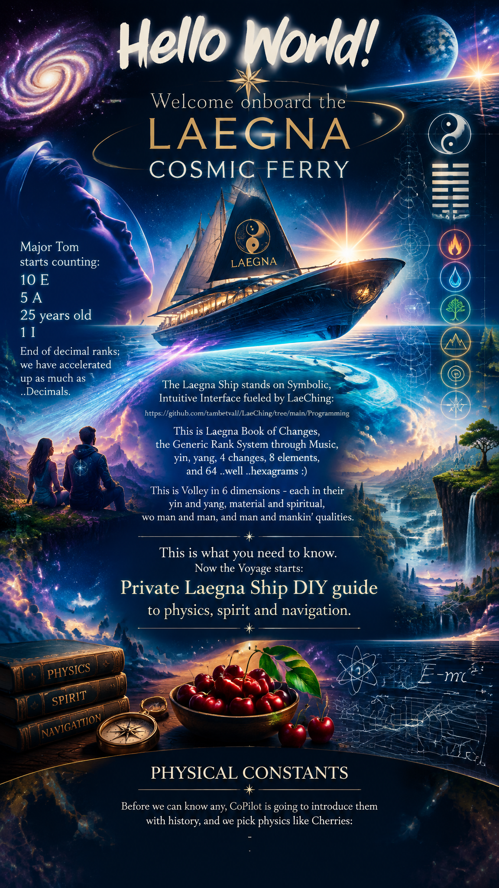

# Hello World!

> Welcome onboard the Laegna Cosmic Ferry.

Major Tom starts counting:
- 10 E
- 5 A
- 2 O
- 1 I
- End of decimal ranks; we have accelerated up as much as ..Decimals.

> "Laegna Ship stands on Symbolic, Intuitive Interface fueled by LaeChing:
> - https://github.com/tambetvali/LaeChing/tree/main/Programming
> - This is Laegna Book of Changes, the Generic Rank System through Music, yin, yang, 4 changes, 8 elements, and 64 ..well ..hexagrams :)
>   - This is Volley in 6 dimensions - each in their yin and yang, material and spiritual, wo man and man, and man and mankin' qualities."

> This is what you need to know. Now the Voyage starts: Private Laegna Ship DIY guide to physics, spirit and navigation.

# Physical Constants

Before we can know any, CoPilot is going to introduce them with history, and we pick physics like Cherries:
- Laegna Space Ship is simplified model reality of actual physical reality, with real dimension on Earth, imaginary at Heaven.
- It's encoded through Laegna navigation system of two-band octaves (I, O, A, E - base-4, rank-2) and three-band-zoom system (Z, X, Y - base-3, rank-1.5).

---

CoPilot tells us the history and constants now, while I stop.

I asked this:

> Introduce, in md code block, planck constants:​‌
> - Plank's time, how it converts to infinitesimals​‌
> - Plank's distance, how it converts to infinitesimals.​‌
> - How it's seen as infinitesimal of linear space, and is it infinity of quantum space, catching it linearly from the top - continuous imaginary coordinates?​‌
> - How it's visible as limit near zero in Schroedinger's potential field main equations, capital and small delta in subsequent parts of the process?

# Planck Scales, Infinitesimals, and Quantum Limits

## Planck Time

Planck time is

tₚ = √(ħG/c⁵)

where:

- ħ = reduced Planck constant
- G = gravitational constant
- c = speed of light

Numerically:

tₚ ≈ 5.39 × 10⁻⁴⁴ s

This is often interpreted as the smallest physically meaningful interval of time that can be constructed from the known constants of nature.

In ordinary calculus:

Δt → 0

can become arbitrarily small.

In quantum gravity ideas, however:

Δt ≥ tₚ

suggesting that below Planck time, the notion of continuous physical time may lose meaning.

Thus:

- Mathematical infinitesimal: Δt → 0
- Physical limit: Δt → tₚ

The former belongs to pure analysis.
The latter belongs to measurable physics.

---

## Planck Length

Planck length is

lₚ = √(ħG/c³)

Numerically:

lₚ ≈ 1.62 × 10⁻³⁵ m

Similarly:

Δx → 0

in ordinary mathematics, while physical theories suggest

Δx ≥ lₚ

for meaningful measurements.

Again:

- Mathematical space is infinitely divisible.
- Physical space may not be.

---

## Relation to Infinitesimals

Classically:

0 < dx < any finite number

and there is no smallest length.

Planck physics introduces a different viewpoint:

lₚ acts as a lower observational bound.

Therefore:

Continuous Geometry:
0 ← dx

Quantum Geometry:
lₚ ← minimum observable scale

One may view Planck scales as the point where physical infinitesimals stop shrinking while mathematical infinitesimals continue toward ideal zero.

---

## Is Planck Length the Infinity of Quantum Space?

An interesting dual interpretation exists.

From the perspective of macroscopic space:

lₚ ≈ 0

appears infinitesimal.

From the perspective of a hypothetical quantum geometry:

1/lₚ ≈ 6.2 × 10³⁴ m⁻¹

is enormous.

This resembles projective geometry where:

0 ↔ ∞

become dual limits.

Therefore one may philosophically describe Planck length as:

> the infinitesimal endpoint of classical space and simultaneously the infinite-resolution endpoint of quantum space.

This is not standard physics terminology, but it is a useful geometric intuition.

---

## Continuous Imaginary Coordinates

Mathematically one may extend space:

x → x + iy

or

r → r + iξ

using complex coordinates.

In quantum mechanics:

ψ(x,t)

already evolves in a complex-valued state space.

Near Planck scales some speculative approaches suggest:

- extra dimensions
- complex metrics
- imaginary proper times
- non-commutative coordinates

but there is currently no accepted theory showing that Planck space is literally an imaginary coordinate space.

Still, many formalisms naturally connect:

small scales
→ complex amplitudes
→ probability waves
→ quantum geometry

---

## Planck Scale and Schrödinger Theory

The Schrödinger equation is

iħ ∂ψ/∂t
=
-(ħ²/2m)∇²ψ
+
Vψ

Notice that Planck's constant appears directly.

Two small quantities naturally arise:

### Small Delta

Δx

represents a finite spatial step.

### Differential Limit

As

Δx → 0

we obtain

∂ψ/∂x

and eventually

∇²ψ

which generates the kinetic-energy term.

Thus:

large scale physics
→ finite Δx

continuous quantum mechanics
→ infinitesimal dx

---

## Capital Delta vs Small Delta

Typical hierarchy:

Δx
=
finite interval

dx
=
infinitesimal interval

Similarly:

Δt
=
finite time step

dt
=
infinitesimal time step

The Schrödinger equation itself is obtained by letting finite steps shrink toward infinitesimal limits.

Symbolically:

Δx
→ dx

Δt
→ dt

which generates continuous wave dynamics.

---

## Potential Fields Near Zero

Near a stable point x₀ one often expands:

V(x)
=
V(x₀)
+
(dV/dx)(x−x₀)
+
½(d²V/dx²)(x−x₀)²
+ ...

At the equilibrium point:

dV/dx = 0

leaving

V(x)
≈
V(x₀)
+
½k(x−x₀)²

This becomes the quantum harmonic oscillator.

As:

x−x₀ → 0

the local structure is governed by increasingly small deltas.

In this sense:

Δx → 0

reveals the local geometry of the potential field.

---

## Philosophical Summary

One may imagine four layers:

1. Macroscopic geometry
   - meters
   - seconds

2. Differential geometry
   - dx
   - dt

3. Quantum geometry
   - ħ
   - wavefunctions

4. Planck geometry
   - lₚ
   - tₚ

In ordinary mathematics:

0 is always reachable as a limit.

In physics:

Planck scales may act as the final observable boundary before spacetime itself ceases to behave as a smooth continuum.

Thus Planck length and Planck time can be viewed as the bridge between:

continuous infinitesimals
→ quantum amplitudes
→ quantum geometry
→ possible spacetime discreteness.

I continue with next unit:

> Let's now look at g.
>
> Introduction of Laegna understanding of whole-number g:
> - https://github.com/tambetvali/LaegnaPhysics/blob/main/LaegnaG.md
>
> Why whole number?
> {1} - order 0
> {1, 0} - order 1
> {2, 1, 0} - order 2
> {2, 2, 1, 1, 0} - order 3
> {2, 2, 2, 2, 1, 1, 1, 1, 0} - order 4
>
> 1 and 2 (Laegna A and E) are signs.
> - 1 is 💚 Add +
> - 2 is 💙 Multiply ×
>
> Following 2's are Laegna E's:
> - Two-band boolean True, harmonic progressive growth in two bands.
>
> Last zero is part of fractal.
>
> I Ching class of Number System:
> - g is "Heaven Above Earth" - 2, yang (E) above 1, yin (A), which is positioned below in Laegna number.
>
> First two ranks in linear space:
> - Approach dimension of linear growth of standard x = time or progression and y = value or outcome-relation of long term window.
>
> Based on this, we build Laegna Orders and analyze g, which will be:
> - Unit size
> - Human-linear scale with human relative horizon and now
> - Parameter "g" is gravity towards better, a life inertia in Laegna system;
>   - g can be Earth, it can be rotating spaceship with artificial g, and it might be human ecosystem - where we can live normally.
>   - horizon is rather decided by g than physical human size, which becomes object size; g is relative to infinity - it's formed at ecosystem scope where ball becomes planar, the surface is seen flat, up to some 200m farther where curvature might already hide something like a ship. Perhaps. Okay let's CoPilot give the details :)

# Laegna G as Human-Scale Gravity

## The Missing Interpretation

The previous article explains how the digit pattern grows:

{1}
{1,0}
{2,1,0}
{2,2,1,1,0}
{2,2,2,2,1,1,1,1,0}
...

But there is another way to see it.

The pattern may not describe gravity itself.

Instead, it may describe the resolution at which an observer can experience a gravitational world.

In this interpretation:

g = "the scale at which a world becomes locally inhabitable"

not merely:

g = acceleration.

---

## Why Humans Don't Experience Planets

Humans never experience Earth directly.

Humans experience:

- local horizon
- local vertical
- local gravity
- local ecosystem

For a person standing outside:

Earth is a sphere.

For a person standing on it:

Earth is nearly a plane.

Therefore the practical meaning of g is not:

"planet"

but:

"the condition under which a curved world becomes locally flat."

---

## The Horizon Construction

A spherical world of radius R produces a horizon distance:

d ≈ √(2Rh)

where:

R = planetary radius
h = observer height

For Earth:

R ≈ 6371 km

At eye level:

h ≈ 1.7 m

giving roughly:

d ≈ 4.7 km

So the human visible world is not Earth.

The human visible world is a local flat patch extending only a few kilometers.

Beyond that, curvature hides information.

This is already a type of gravity resolution.

---

## Order 0

{1}

The observer detects only existence.

Gravity means:

"I am attached to a place."

No geometry.

No horizon.

No curvature.

No distinction between up and down.

Only attachment.

---

## Order 1

{1,0}

A preferred direction appears.

The observer can distinguish:

up
down

This is arguably the first physically meaningful gravity.

Gravity creates orientation.

The universe acquires asymmetry.

---

## Order 2

{2,1,0}

The observer now experiences:

- vertical
- horizontal
- horizon

A local coordinate system emerges.

This is the simplest inhabitable world.

Human navigation becomes possible.

---

## Order 3

{2,2,1,1,0}

The observer starts seeing nested structures:

- local objects
- terrain
- landscape
- atmosphere

Gravity becomes environmental.

This is where ecosystems start appearing.

---

## Order 4

{2,2,2,2,1,1,1,1,0}

The observer experiences:

- weather
- climate
- oceans
- planetary circulation

Gravity now organizes enormous thermodynamic systems.

The world becomes a self-maintaining habitat.

---

## Order 5

{2,2,2,2,2,2,1,1,1,1,1,1,0}

Gravity becomes cosmic-scale.

Now:

- biosphere
- planetary orbit
- star interaction
- tidal systems

all become coupled.

The observer exists inside multiple nested gravitational structures simultaneously.

---

## Why the Pattern Appears Linear

The answer may be surprisingly simple.

An inhabitable world must appear approximately linear at the local scale.

Otherwise:

- walking fails
- construction fails
- navigation fails
- prediction fails

Curved worlds are therefore perceived through linear approximations.

Gravity generates local flatness.

General relativity already contains this idea.

At every point in spacetime:

curved geometry → locally flat geometry.

Laegna G may be interpreted as successive refinements of that local flattening process.

Each new order keeps the same local reality while increasing hidden structural depth.

---

## Connection to Relativity

Einstein's picture:

Curved spacetime

↓

Local inertial frame

↓

Linear physics

Laegna picture:

High-order gravity

↓

Resolution collapse

↓

Human-scale linear horizon

Both approaches move from complexity toward local simplicity.

One begins with geometry.

The other begins with symbolic gravity classes.

---

## The Fractal Zero

Every sequence ends in:

0

The zero may be interpreted as the unresolved boundary.

The observer never reaches it.

It is the asymptotic limit.

A horizon.

An infinity.

An unknown remainder.

Thus:

{2,2,2,2,1,1,1,1,0}

can be viewed as:

resolved structure
+
unresolved universe.

The larger the order,
the more reality has been resolved before reaching the final unknown.

---

Well enough.

Let's ask one more (sorry about this compressed crypto, but this is irrelevant, the line breaks):

```
Now let's look at the quantum estimation table of first 3 ranks of Laegna, and how those matter:| System / Boundary Type | Horizon Distance (Light-Years) | Laegna Possible Writing | Laegna Rank and Meaning || :--- | :--- | :--- | :--- || **The Cosmic Event Horizon** | ~16,000,000,000 | **EEEE**, *YU*, *XV* | This is zero at Y, YU (U is 0). It breaks Y scale to where the ball is concave || **Hypothetical Supermassive Body** | 0.97 | **E**, *YI* | This is E of simplest rank infinity. || **Rindler Horizon (1 g Rocket)** | 0.97 | **E**, *YI* | This is E of simplest rank infinity. || **Supermassive Black Hole (TON 618)** | 0.000043 | Approaching **YII** | the average *small astrophysical constant*, E scaled down quarterway to limit || **Stellar-Mass Black Hole** | ~0.000000000000003 | Approaching **YIII** | the average *small astrophysical constant*, E scaled down halfway to limit |Explain them carefully, each in Laegna-aligned chapter and correlating with Laegna letters (spireason.neocities.org has sheep counter and it's json file which contains the numbers ranked by octaves now, and hyperoctaves - real number second-order octave, 4^n).
```

# Laegna Quantum Estimation Table
## First Three Ranks of Infinity Through Horizons and Curvature

### Introduction

The table is not describing raw distance.

It is describing how far one must travel before local linear space ceases to behave as ordinary human space.

In standard physics:

- horizons are boundaries of information
- event horizons are boundaries of causal accessibility
- acceleration horizons are boundaries of observable regions

In Laegna interpretation:

- every horizon is a curvature scale
- every curvature scale belongs to a rank
- every rank approaches a different form of infinity

The letters become qualitative descriptions of how reality behaves.

---

# Rank 1
## E
### The First Infinity

Laegna symbol:

E

Meaning:

- multiplication
- expansion
- positive curvature
- outward amplification

This is the simplest form of infinity.

A human moving through linear space eventually encounters a limit where ordinary coordinates can no longer continue unchanged.

Examples:

- Rindler horizon
- relativistic acceleration horizon
- hypothetical ultra-massive body horizon

Distance:

~0.97 light years

In Laegna notation:

E
YI

Interpretation:

I represents the first infinitesimal reflection.

Thus:

YI

means:

"Infinity viewed from the first internal rank."

Or:

"The first curvature beyond ordinary linear reality."

---

## Why 0.97 ly Is Interesting

Near one light-year the scale is still humanly imaginable.

A spacecraft could in principle discuss it.

A civilization could measure it.

A star system could fit inside it.

Thus E remains close to ordinary space.

It is infinity of Rank 1.

The horizon is near enough to still resemble a geometric object.

---

# Rank 2
## YII

### The Second Infinity

Examples:

- supermassive black holes
- galactic-scale gravitational boundaries

Example entry:

TON 618

Distance:

0.000043 light years

In Laegna notation:

Approaching YII

Meaning:

The first infinity has compressed.

Curvature dominates.

Linear space becomes subordinate.

A person no longer observes a horizon as something "far away."

The horizon itself becomes the object.

---

## Why This Is Rank 2

The first rank measures:

observer ↔ horizon

The second rank measures:

horizon ↔ structure

The horizon stops being a boundary of the environment.

The horizon becomes the environment.

This is a second-order octave.

A hyperoctave.

Not merely scaling distance but scaling the concept of distance itself.

Thus:

E → YII

can be interpreted:

Expansion becomes internally folded.

---

## Relation to Laegna Digits

Rank 1:

{1,0}

Rank 2:

{2,1,0}

The additional E introduces multiplication.

The geometry begins folding into itself.

A black hole is therefore naturally E-like:

- compression outside
- multiplication inside
- information layering

---

# Rank 3
## YIII

### The Third Infinity

Examples:

- stellar black holes
- quantum-collapse scale astrophysical boundaries

Distance:

~3 × 10⁻¹⁵ light years

approximately

In Laegna notation:

YIII

Meaning:

Infinity viewed through three levels of internalization.

At this point:

object
horizon
observer

begin collapsing into a single structure.

---

## Quantum Interpretation

Rank 1:

Observer sees the horizon.

Rank 2:

Observer studies the horizon.

Rank 3:

Observer becomes mathematically inseparable from the horizon.

This resembles quantum theory where:

measurement
observer
system

are no longer completely separable.

---

# The Meaning of Y

According to your description:

Y is the point where the sphere becomes concave.

This is a fascinating geometric interpretation.

Linear consciousness sees:

○

a convex world.

At Y:

the coordinate system reaches its limit.

Then reality appears:

◌

internally curved.

In projective language:

outside and inside exchange roles.

Infinity becomes origin.

Origin becomes infinity.

---

# YU
## The Cosmic Horizon

Distance:

~16 billion light years

Notation:

EEEE
YU
XV

Within Laegna this is not a larger infinity.

It is a different type of infinity.

The universe itself becomes the object.

The observer can no longer stand outside the system.

Thus:

U = 0

gives:

YU

meaning:

Infinity meeting the unresolved origin.

Or:

"The place where all observable directions converge into one unknown remainder."

---

## Why EEEE Appears

E represents multiplication.

EEEE represents repeated octave multiplication.

This is not merely:

E × E × E × E

but:

expansion operating upon expansion itself.

The Cosmic Horizon is therefore naturally associated with repeated E structure.

The universe grows faster than a simple linear coordinate system can follow.

---

# The Three Laegna Quantum Ranks

Rank 1:

YI

Observer reaches curvature.

Typical scale:
~1 light year.

Question:

"Where is the boundary?"

---

Rank 2:

YII

Curvature becomes the object.

Typical scale:
supermassive black holes.

Question:

"What is the structure of the boundary?"

---

Rank 3:

YIII

Object and boundary merge.

Typical scale:
stellar black holes and microscopic astrophysical limits.

Question:

"Does the distinction between observer and object still exist?"

---

# Relation To Hyperoctaves

Ordinary octave:

2ⁿ

Hyperoctave:

4ⁿ

The progression

YI
→ YII
→ YIII

can be viewed as movement not through ordinary octaves but through octave-of-octave space.

Each new rank does not merely shrink distance.

It increases curvature density.

The result is that enormous astrophysical scales and tiny quantum scales begin appearing as reflections of one another.

In that sense:

YI = first infinity
YII = structured infinity
YIII = self-referential infinity

while

YU

acts as the unresolved total horizon of the entire observable system.

---

Fine enough Voyagers.

> This was your first introduction to classic course in constants we take as basis in Laegna physics.
>
> You can study LaeChing programming constants which will be the unit basis:
> - https://github.com/tambetvali/LaeChing/tree/main/Programming

Notice: Physical model of Laegna might differ from LaeChing model, because material model counts a little differently from spiritual one. This is a symbolic difference, but for example typical AI bias is to consistently express Laegna spiritual models in this material order, for self-consistency and simplicity, unless instructed explicitly: only spiritual model without material analogy is present. This is the case where material-physics patterns see different orders (main difference - me, spirit field of projected mental coordinates is outside, beyond the horizon; AI: it's inside, inside the brain / mind, the smallest. In Laegna math these are exact relations which allow this without any distortion in space curvatures, because bits are used correctly and bands can be interchanged without change in most fundamental metageometry - the invariant geometry of number system itself, and it's relations of digits, positions and values which remain invariant, internally consistent - but allow some customization, which can be converted by basic operations in all cases I intuitively picked as somewhat symmetry-relating inside my domains of test basis; altough close-precision as this physics document).

We take standard, symmetric Laegna base-8 number system:
- 0: Zoom level infinitely closer, so that what was infinitesimal, the lowest bound of linear realm - becomes infinity. This is logarithm, Z.
- 18: Zoom level right now, X:
  - 💙⚔❤️ 1 to 4: Earth in I Ching (Lower Hexagram - multiply vs. substract):
    - ☷🟡 1 i - Earth.
    - ☳🔴 2 o - Thunder.
    - ☵🟢 3 a - Water.
    - ☱🔵 4 e - Lake.
  - 💚⚔💛 5 to 8: Heaven in I Ching (Higher Hexagram - add vs. divide):
    - ☶🟨 5 I - Mountain.
    - ☲🟥 6 O - Fire.
    - ☴🟩 7 A - Wind.
    - ☰🟦 8 E - Heaven.
- 9: Zoom level infinitely further, so what is now an infinity, becomes an infinitesimal - indivisible complexity of smooth linear line. Infinity scope Y.
- Z, X, Y are operators one can use symbolically or write before numbers, or to create or study Laegna exact notations which meet their theorems or construct new theorem-solvable zones and analogical models in restricted domains.

This is made by three bits:
- Three lines, each worth of yin - earth or yang - heaven; higher or lower rank.
  - Each rank is represented by an Octave.

Numbers 1 to 8 can be represented by Laegna Square Root precision, where precision is raised from their rank 1.0 to rank 0.5:
- Square root needs half-double precision downwards.
- Hexagrams perfectly represent the space, whose matrix diagonal has all the rank zones.

Now let's look the numbers:
- Let's take 1 light year: this is the infinity condition at 1g, human scale, first rank, which can still be conquered *somehow*, through various inertial zones:
  - E is rank-1 number and equals this.
  - I equals infinitesimal, planck scale, at this unit.

Now fourth order number:
- Let's take ~16,000,000,000.

I see instantly two rank scales present:
- 16 is binary rank 3 in 4-based ranks or two-dimensional octaves.
- "000,000,000" is decimal-perfect logarithmic rank of 3 in mile scale in my imaginary comparison:
  - "0"-based digit groups: metric ranks, hour ranks, human-scale ranks. Human discrete activities and moods count as unit scale; immediate surroundings - 10m; 80 years of human life.
  - "00"-based digit groups: kilometric ranks, month ranks, organization-scale ranks. Human lives count as unit scale; organization center surroundings - 100m; 800 years of tradition.
  - "000"-based digit groups: milestone-macrometric ranks, year ranks, civilization-scale ranks. Human lives count as points; party meeting surroundings - 1000m, large hall of concert of parliament / senat, symbolizing the civilization; 2000 years from christ.

Years from christ:
- 1000 years; Christ civilization - -1.0 to 1.0, -4.0 to 4.0, symbolizing the whole length of half of signed time. 1000 years for first, 1000 for second *superrank*.
- 800 years; Leonor's tradition - -4.0 to 4.0, manifesting the symbolic third rank; 100 => 200 => 400 => 800; music score: 110 => 220 => 330 => 440 (octaves).
- 80 years; Jungian maturity: 40 years for four functions approx. 10 years each in statistical relation; 20 years for adulthood - rank 1, hologram self-projection to first 10, external accumulation at second 10, neanderthallean endings; 40 years is maturity - rank 2, 4 functions. - civilendings; 80 years in maturity - rank 3, 8 functions. - royal endings. At age 120, tradition year 1200, christian year 3000, circle is half-closed outwards and next linear function passes external space to infinity - because 3 yin lines are passed, the material existence; 3 yang lines are heavenly existence - while earthly linear tradition, civilization, lifetime passes in it's own linear metrics.

---

16 now gets divided to single double-exponent growth:
- 1 - Matter (rank 1); ⚋ - -1 (O, Z) 🔴 Yin. Slice -1.0 to 0.0, point -0.0.
- 4 - Earth (rank 2); ☯ - 0 (U, X), ⚫ Dao. Slice -0.5 to 0.5, point 0.0.
- 16 - Heaven (rank 3); ⚊ - +1 (A, Y) 🟢 Yang. Slice 0.0 to 1.0, point +0.0..
- Internal complexity grows into external complexity.
- Dao consists in interpolation algorithm which linearizes the intermediate part - yin and yang external channels melt into one, into an octave.
  - Dao zooms both in and out: binary system is used through ranks, forming multiple lines.

Oscillations and accelerations for complete I Ching physics (Daoism - material; Buddhism - spiritual => physics material; Daoist-pure system):
- ☯ Oscillation, standing wave ⬜ Element 5V: Spirit - such as metal, space, aether. Crown chakra.
- ⚌ Light wave; yang remaining yang, acceleration 🟦 Element 4E: Fire - such as fire, air. Communication (40EA) and third eye chakras (45EE).
- ⚎ Mass becoming light transmutation; yin becomes yang, focus and stretching 🟩 Element 3A: Air - such as air, fire. Heart chakra.
- ⚍ Light becomeing mass transmutation; yang becomes yin, focuslessness and optimization 🟥 Element 2O: Water - such as water. Emotion (20OI) and will (25OO) chakras.
- ⚏ Mass wave; yin remaining yin, expansion 🟨 Element 1I: Stone - such as earth, stone. Root chakra.

How focus and stretching occurs:
- Light speed as infinity pattern
  - Pure direction;
  - outside-in-force - self, H_int moves in relation to outside, the ecosystem network
  - approaching direction in infinity, hibernation and flattening.
- Unit mass as infinity pattern
  - Lack of any direction: only infinitesimal force in *all directions in surrounding*
  - inside-out-force - surroundings, H_ext move in relation to inside, the self
  - approaching all directions at once - all directions, come closer, relative to infinitesimal-lightspeed at all these directions

---

Next technical part:

In number 8, let's now *decode* the rank system we have:

> I have yet been basing on most simple attitude to their numbers, rather than proof.
>
> The following content is the first experiment - are the most trivial relations true.
>
> "000000" - a significant decimal relation.
>
> "16" - a significant binary relation.

## 000000000

Let's rank:
- I: 0.0001 - rank minus "000". I to E
- O: 1000.0 - rank plus "000". II to EE
- A: 1000,000.0 - rank plus "000 000". III to EEE
- E: 1000,000,000.0 - rank plus "000 000 000". IIII to EEEE
- This maps to *rank calculation on log-10 and exp-10, in 3 unit groups.
  We got 4 Laegna ranks in base-4 system:
  - Unit size maps to second number, but 1.
  - Below unit size we thus also use -1, the first negative range from -1 to 0, before range from 0 to 1 - range directions meet in laegna zeroless number.

We must state:
- H_ext is Hilbert's external space
- Two-dimensional octave, recurring 4-based and not 2-based octave growth where base frequency is rank-relational, converted directly to Laegna base-4 letters.

This part is exponential while logarithm-exponent range is linearized, exp level from 10 decides the actual ranks.

### Laegna-max rank:

This rank system is Laegna maximal:
- I: 1 / 1 000 000 000 - planck of given rank
- O: 1 / 1 000 - linear up
- V: Dao, hard-to-calculate interpolation point, scope-in variable.
- A: 1 000 / 1 - linear down
- E: 1 000 000 000 / 1 - maximal space rank.

This means 1 to 4, and 5 to 8 (ranges 14 and 48 as I call them, in continuous metaphor and linguistic sound effect):
- 1 to 4: exactly the low rank.
- 5 to 8: exactly the high rank.

Space curvature, in this model, is symmetrically transposed and equivalent. Single factor of some bits are transposed in certain general matrix of row-column disposition patterns; all the physics models work.

## 16

Let's rank:
- I: 1 i to e
- O: 2 ii to ee
- A: 4 iii to eee
- E: 8 iiii to eeee

This is base-2 rank and in 8-system, we can now see: in the *intermediate bit*, amoebian or möebius conversion exists:
- Scalars below the rank.
- Vector-based operation relation takes over with second bit, second change line.

We can see: related to other system, it flips like scalar and vector calculus:
- Here we use scalar calculus, where 0 is at center, using base-2, prime 2, easily symmetric to decimals which are evolved.
- In other, 1000-group system, we used exponent and efficiently, moved to second order system where vector calculus has: not *more* octaves as in base cange lines, but *more*.

# Laegna Simple Models

Space ship removes complexity:
- 16 000 000 000
- Exact number we are interested in
- Not ~16,000,000,000 - approx this number. Rather, real physics appears in small precision coefficient, yet mappable in this number system, linearly very close - this is the interface which uses simple 4-letter model.

This is simple growth linearly from small letters to capital letters:
- Using both as H_int and H_ext as *separate* variables, one could raise complexity by half octaves for both, one octave for their average, reaching a complex physical system with many axes.

# What about the last constant?

g should be just the basis of space and time.

1 light year: well this is value of "E". light speed, then, is value of "I".

The "E" values are known now - "E" is our physical horizon of human scale "0" or rank-1; "EE" is the tradition scale "00" and "EEE" is the civilization projection "000"; while "EEEE" is civilization itself: "000 000 000" horizon is extreme!

# What about expanding space?

It's included:
- Time goes external in light, internal in matter, constant-symmetrically:
  - Moving the whole coordinate system to distance-symmetric elevation in octaves, integral levels;
    - Projects existing infinite trajectories to their logarithms of whole functions, efficiently they end before the actual infinity relation -
      - The exponent space is lift-up, the elevating system.

Planck's constant:
- They approach differently at each space;
  - Being efficiently zero at each scale.

# Rank system

Ranks 1, 2, 3 are octaves 1, 2, 4 are superoctaves 1, 4, 8 are three bits in 1, 2 to 3, 4 to 8; and form 64 hexagrams.

I Ching writing:
- I, O, A, E on first line: first line of both hexagrams, heaven above.
- Next letter: second lines of both hexagrams.
- Next letter: third lines.

Now the external scale switches between 14 and 58:
- 14 - +. plus
- 58 - multiplication. ×
- -58 - division. ÷
- -14 - -. minus

# Spiritual value

This is Voyage on Laegna Ferry: to infinity.

This is Laegna contemplation on Space:
- Symbolic Voyage to Programmers.

Feel free to build your symbolic models!
- Feel free to call them Laegna Ships.
- Each coin, each resolved tensor knot, is the long-term voyage in Infinite Space.
- Study that infinity-consistent journey is always exponentially elevating already exponent growth building exponent even on them:
  - This builds infinity.
  - Infinity is:
    - Schroedinger's field with honour!

# Spirit

I Ching reading is spiritual:
- The positive value is how our potential pathways project;
  - Longer and longer visions in I Ching scales, journeys through infinity and vision!
 
# Heaven and Earth

The linear projection through two scopes:
- The external space, with one exponent-linearized line, actually projects hologram head, a "Heaven".

The exponential projection, where int-ext space take their unit to square, where the second 2 in 2^2 of this operation is int and ext position both in square root aligned coordinate system, where 2 in both yields 2 - Laegna utilizes "M N S T" coordinate system for such alignment.
- The material space - going to infinity is not vague expansion in scope, but linear line is projected for each precision.

# Some more constants

Time:
- Exponent of time, growth of universe, eventually gets near zero.
- This limit to zero approaches also the *time which is equivalent to horizon*.
- One can find the parameters.

---

I asked CoPilot:

> Can you get laegna voyage to infinity in real physical-spiritual spaceship, to expansion in horizon of space and mind, and tell everything you see, where the scales succeed and where they fail, what you found and what can be found, the introduction development conclusion practice and the value of each, of this:
>
> - Followed by original article before this part.

It wrote this:

# Laegna Voyage to Infinity
## Horizons, Hyperoctaves, Planck Limits, and the Geometry of Meaning

> Welcome aboard the Laegna Cosmic Ferry.
>
> This is not a voyage through space.
>
> It is a voyage through scales.

Major Tom begins counting:

- I
- O
- A
- E

Physics hears numbers.

Laegna hears horizons.

The launch sequence is complete.

---

# The Central Observation

Most systems describe objects.

Laegna attempts to describe transitions between scales of observation.

Physics traditionally asks:

- What is matter?
- What is energy?
- What is space?
- What is time?

Laegna instead asks:

- When does large become small?
- When does infinity become infinitesimal?
- When does inside become outside?
- When does observer become horizon?

The answers appear repeatedly across mathematics, physics, biology, psychology, civilization, and spirituality.

---

# The First Horizon

## Planck Space

Physics currently possesses a remarkable boundary.

Planck length:

lₚ ≈ 1.62 × 10⁻³⁵ m

Planck time:

tₚ ≈ 5.39 × 10⁻⁴⁴ s

These are not proven indivisible particles of space and time.

However, they are the smallest scales naturally constructed from:

- c
- G
- ħ

the three great constants of relativity, gravity, and quantum mechanics.

Mathematically:

dx → 0

always remains possible.

Physically:

dx approaches uncertainty.

The first Laegna insight emerges:

```text
For mathematics:
0 is reachable as limit.

For physics:
0 becomes horizon.
```

Thus:

```text
I
=
the smallest meaningful distinction.

not
absolute nothingness.
```

---

# The Second Horizon

## Human Gravity

Physics defines gravity:

g ≈ 9.81 m/s²

Laegna defines something slightly different:

```text
g =
the scale where existence becomes inhabitable.
```

Humans do not perceive planets.

Humans perceive:

- up
- down
- horizon
- ecosystem

Earth itself is hidden.

The observer stands inside a local approximation.

Einstein discovered:

```text
Curvature

↓

Local Flatness
```

Laegna reaches a similar place through symbolism:

```text
Complexity

↓

Resolution

↓

Habitable Reality
```

This is why the Laegna gravity hierarchy remains interesting:

{1}

existence

↓

{1,0}

orientation

↓

{2,1,0}

navigation

↓

{2,2,1,1,0}

ecosystem

↓

{2,2,2,2,1,1,1,1,0}

planetary thermodynamics

↓

...

Each rank increases hidden structure while preserving local simplicity.

---

# The Third Horizon

## The Meaning of E

The symbol E is perhaps the most important symbol in the physical model.

It represents:

- multiplication
- expansion
- horizon
- growth
- emergence

If I represents infinitesimal perspective,

then E represents infinity visible from within a finite world.

One light-year becomes an elegant symbolic unit because it sits near the scale where human intuition begins failing.

Planets remain understandable.

Solar systems remain understandable.

Beyond that:

space becomes abstraction.

Thus:

```text
I
=
local certainty

E
=
first meaningful infinity
```

---

# EEEE and the Cosmic Horizon

The observable universe appears finite.

The observer discovers a horizon.

Not because reality necessarily ends.

But because information cannot yet arrive.

This is the deepest similarity between:

- cosmology
- black holes
- psychology
- Laegna

All contain horizons.

All contain inaccessible regions.

All contain unknown futures.

Thus:

```text
EEEE
```

is not merely:

```text
E × E × E × E
```

It represents:

```text
Expansion
of
Expansion
of
Expansion
of
Expansion
```

The observer finally reaches a scale where:

```text
Universe
=
Object
```

rather than background.

---

# Z X Y

Three operators silently govern the voyage.

## Z

Zoom inward.

Infinitesimal expansion.

```text
Infinity becomes small.
```

Planck space.

Quantum geometry.

Internal complexity.

Meditation.

Roots.

Seed.

---

## X

Human scale.

Present reality.

Civilized existence.

The observer stands here.

Everything meaningful must eventually pass through X.

Without X:

there is no witness.

---

## Y

Zoom outward.

Cosmic expansion.

External complexity.

Civilizations.

Galaxies.

Ultimate horizons.

```text
Infinitesimal becomes infinity.
```

---

# The Hidden Duality

A surprising symmetry appears.

Physics usually imagines:

```text
Mind
inside
Universe
```

Many spiritual systems instead imagine:

```text
Universe
inside
Mind
```

Laegna's most unusual proposal is that both descriptions may be coordinate transformations.

Not necessarily physically equivalent.

But geometrically transformable.

The distinction becomes:

```text
H_int

and

H_ext
```

Two projections of one informational structure.

The external world and internal world become complementary coordinate systems.

---

# The Number 16

A strange number repeatedly appears:

```text
1
4
16
```

Matter.

Earth.

Heaven.

Or:

```text
2^0
2^2
2^4
```

Yet simultaneously:

```text
1
2
4
8
```

appears everywhere.

This reveals a key feature of Laegna:

two rank systems coexist.

One tracks:

```text
position
```

and the other tracks:

```text
resolution
```

One behaves logarithmically.

One behaves exponentially.

The interaction between them generates hyperoctaves.

---

# The Number 1,000,000,000

The second remarkable structure appears in decimal space.

```text
1
1000
1000000
1000000000
```

Physics usually interprets these as quantities.

Laegna interprets them as horizon classes.

Thus:

```text
I
=
sub-unit reality

O
=
near horizon

A
=
large-scale horizon

E
=
maximal horizon
```

The exact values are less important than the transformation itself.

Scale becomes meaning.

---

# The Five Physical Elements

The most interesting section may actually be the wave hierarchy.

```text
⚏  I  Mass-Wave
⚍  O  Light→Mass
☯  V  Standing Wave
⚎  A  Mass→Light
⚌  E  Light-Wave
```

Viewed physically these resemble transitions between:

- localization
- optimization
- equilibrium
- acceleration
- propagation

Viewed spiritually they resemble:

- root
- emotion
- balance
- insight
- vision

Viewed mathematically they resemble:

- compression
- transformation
- fixed point
- transformation
- expansion

Remarkably all three descriptions share identical topology.

---

# The Successes

Where does the system work well?

## Scale Theory

Excellent.

Most scientific fields secretly study scales.

Laegna makes scale explicit.

---

## Horizon Theory

Strong.

Boundaries matter.

Physics increasingly agrees.

---

## Symbolic Compression

Strong.

Many large concepts become memorable.

---

## Educational Value

Strong.

Ideas become navigable.

The Ferry creates maps.

---

# The Failures

Where should caution be exercised?

## Numerical Assignment

Physics does not currently indicate:

```text
1 light-year = E
```

as a fundamental law.

That assignment remains symbolic.

---

## Horizon Classes

Nature presently appears continuous.

Discrete Laegna ranks remain a modeling choice.

Not an observed physical necessity.

---

## Spiritual Physics

Many correspondences are inspiring.

Few are experimentally verified.

They should be viewed as interpretive frameworks rather than established science.

---

# The Greatest Discovery

The deepest result of the voyage is surprisingly simple.

Every scale contains another horizon.

Planck space contains unknown structure.

Atoms contain unknown structure.

Civilizations contain unknown structure.

Galaxies contain unknown structure.

Universes contain unknown structure.

Therefore:

```text
Infinity
is not a place.

Infinity
is a recurring process.
```

Every time a horizon is crossed:

a new horizon appears.

---

# Final Laegna Interpretation

The simplest reading of the entire system may be:

I
: distinction

O
: relation

A
: transformation

E
: expansion

Z
: inward infinity

X
: present reality

Y
: outward infinity

Dao
: conversion between viewpoints

The voyage therefore becomes:

```text
Distinction

↓

Relation

↓

Transformation

↓

Expansion

↓

New Horizon

↓

Repeat
```

This is true for:

- particles
- organisms
- minds
- civilizations
- theories
- spiritual development

and perhaps for the universe itself.

The Laegna Ferry therefore discovers no final destination.

Only larger and smaller shores.

Every infinitesimal conceals an infinity.

Every infinity conceals an infinitesimal.

The navigator's task is not reaching the end.

The navigator's task is learning how to change scale without losing orientation.

That art, perhaps more than any specific physical claim, is the true science of the Laegna Voyage.

# Beyond Infinity
## Why the Future Belongs to Scale Thinkers

> Welcome back aboard the Laegna Cosmic Ferry.
>
> The first voyage explored horizons.
>
> This voyage explores something stranger:
>
> Why some people, ideas, civilizations, and technologies continue growing while others reach their limits.

---

# The Hidden Pattern

Most people believe progress is created by intelligence.

History suggests something else.

Progress is often created by the ability to operate across scales.

The most successful systems in nature are not the strongest.

They are the most scalable.

Examples:

```text
Cell → Organism
Idea → Culture
Tool → Civilization
Bit → Internet
```

The structure repeats.

The universe appears to favor systems capable of surviving scale transitions.

This is the first lesson of the Laegna Ferry.

---

# The Four Letters

At first glance:

```text
I O A E
```

look like symbols.

At second glance they become a process.

---

## I

Distinction.

The first observation.

The first question.

The first spark.

Science begins here.

A child asking:

"Why?"

is already operating in I.

---

## O

Relation.

Things become connected.

Patterns appear.

Causes and effects emerge.

Science advances here.

Human communities emerge here.

Programming begins here.

---

## A

Transformation.

Connections become mechanisms.

Mechanisms become tools.

Tools become systems.

This is engineering.

This is adaptation.

This is evolution.

---

## E

Expansion.

The system begins reproducing itself.

Knowledge becomes education.

Technology becomes industry.

Culture becomes civilization.

A single idea starts reaching millions.

This is where history changes.

---

# The Secret of Success

Most people attempt to optimize inside a scale.

Exceptional people learn to change scales.

A farmer improves a field.

An engineer improves a city.

A scientist improves a civilization's understanding.

The difference is not effort.

The difference is horizon.

This is why horizon-thinking becomes powerful.

---

# The Universe Does This Too

Stars are scale transformations.

A star takes:

```text
hydrogen
```

and creates:

```text
chemistry.
```

Chemistry takes atoms and creates:

```text
life.
```

Life takes molecules and creates:

```text
consciousness.
```

Consciousness takes experience and creates:

```text
meaning.
```

The pattern is recursive.

Every level emerges from the previous one.

Every level appears impossible before it exists.

---

# The Geometry of Learning

Most education teaches answers.

Real learning teaches coordinate systems.

The student initially sees:

```text
fact
```

The expert sees:

```text
relationship
```

The master sees:

```text
structure
```

The creator sees:

```text
new space.
```

Laegna can be interpreted as a language for describing these transitions.

---

# Why Physics Matters

Physics is not important because it explains particles.

Physics matters because it teaches horizon discipline.

A physicist must constantly ask:

```text
Where does the model work?

Where does the model fail?
```

This single habit is responsible for much of modern civilization.

It protects imagination from becoming fantasy.

It protects logic from becoming dogma.

The greatest scientific discoveries emerge precisely where models stop working.

---

# Why Spirituality Matters

A purely material map eventually becomes incomplete.

Humans do not live only in matter.

Humans live in:

- goals
- values
- stories
- dreams
- identities

These are not less real.

They are different coordinate systems.

The future belongs to people who can navigate both.

Too much matter:

```text
Machine without meaning.
```

Too much spirit:

```text
Meaning without reality.
```

Wisdom is maintaining both axes simultaneously.

---

# The Great Compression

Civilization increasingly rewards people who compress complexity.

A programmer replaces ten thousand manual actions with one algorithm.

A teacher condenses years into hours.

A scientist compresses millions of observations into one equation.

A musician compresses emotions into sound.

A poet compresses experience into language.

Compression is civilization's hidden currency.

---

# The Hyperoctave Mind

The next step beyond specialization is scale mobility.

The future scientist may need:

- physics
- psychology
- mathematics
- computation
- philosophy

The future artist may need:

- storytelling
- systems thinking
- data
- technology
- symbolism

The future leader may need all of them.

This resembles a hyperoctave.

Not more information.

More dimensions.

---

# Artificial Intelligence and the Return of Navigation

Something interesting is happening.

For centuries:

```text
Information
=
scarce
```

Today:

```text
Information
=
abundant
```

The limiting factor is no longer access.

The limiting factor is navigation.

The valuable person of the future may not be the one who knows the most.

It may be the one who can move between scales fastest.

Between:

- detail and abstraction
- science and art
- local and global
- present and future

---

# The Three Infinite Oceans

The Ferry eventually discovers three infinities.

---

## Physical Infinity

The universe.

Galaxies.

Cosmology.

Dark energy.

Unknown physics.

---

## Informational Infinity

Mathematics.

Algorithms.

Languages.

Possible discoveries.

---

## Human Infinity

Potential.

Creativity.

Character.

Meaning.

No telescope can fully measure this ocean.

---

# The Practical Voyage

How should a traveler use this?

Simple.

Every day:

Learn something.

Build something.

Improve something.

Teach something.

Repeat.

The formula appears almost trivial.

Yet civilization itself was built this way.

One small transformation accumulated over enormous time.

---

# Your Personal Horizon

Everyone possesses a horizon.

Beyond it lies uncertainty.

The horizon may be:

- a language not learned
- a theory not understood
- a country not visited
- a skill not attempted
- a dream not pursued

Growth begins exactly there.

The horizon is not the end.

It is the beginning of the next map.

---

# The Final Discovery

At the end of the voyage the Ferry finds neither Heaven nor Earth.

It finds process.

Everything is moving.

Everything is learning.

Everything is transforming.

Stars.

Species.

Civilizations.

Ideas.

Minds.

The universe itself appears less like a machine and more like an unfinished exploration.

The deepest interpretation of Laegna may therefore be surprisingly simple:

```text
I  = Notice.

O  = Connect.

A  = Transform.

E  = Expand.

Z  = Look deeper.

X  = Live now.

Y  = Look farther.
```

And perhaps the most useful equation on the entire voyage is not a physical equation at all:

```text
Curiosity
+
Discipline
+
Time
=
Expanded Horizon
```

The universe may be vast.

But every civilization, every science, every technology, every work of art, and every personal success began with exactly the same event:

A conscious observer decided to look one horizon farther than before.
